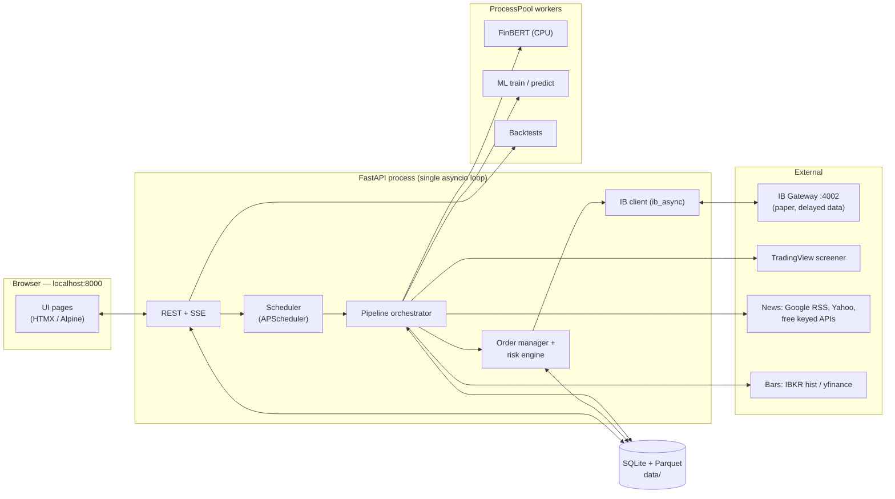
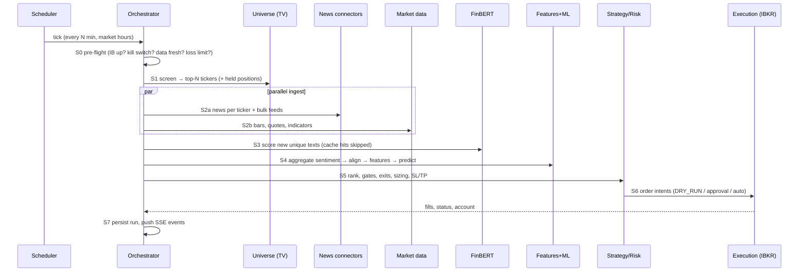
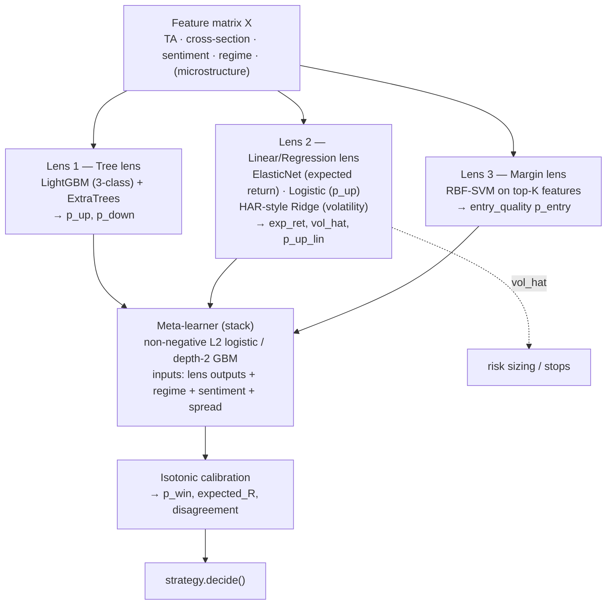

# IBKR News-Sentiment + ML Short-Term Trading Bot — Implementation Plan

**Target:** a local, single-machine pipeline that (1) screens ~50 US stocks, (2) scrapes news + market data, (3) scores text with FinBERT (CPU), (4) predicts with a stacked classical-ML model, (5) backtests, (6) ranks / sizes / risk-manages up to 5 positions and (7) trades through **IB Gateway (port 4002, market data type 3)** — all controlled from a clean `localhost` web UI.

**Plan date:** 4 Nov 2026 · **Status:** design document (no code written yet) · **Default mode:** paper trading only

> **How to read this document.** §1–3 are the decisions and the constraints that shape everything else. §4–6 are setup. §7–12 are the pipeline modules in the order data flows through them. §13–15 are the web app and testing. §16–19 are milestones, safety, risks and open questions. Appendices hold schemas, pseudo-code and wireframes.

---

## Table of contents

1. [Executive summary & key decisions](#1-executive-summary--key-decisions)
2. [Reality checks that change the design](#2-reality-checks-that-change-the-design)
3. [System architecture](#3-system-architecture)
4. [Environment (conda, Python, libraries)](#4-environment-conda-python-libraries)
5. [Repository layout](#5-repository-layout)
6. [Configuration & adjustable parameters](#6-configuration--adjustable-parameters)
7. [Data layer & storage](#7-data-layer--storage)
8. [Stage 1 — Universe, news & market data](#8-stage-1--universe-news--market-data)
9. [Stage 2 — FinBERT sentiment & tabularization](#9-stage-2--finbert-sentiment--tabularization)
10. [Stage 3 — Market analysis: the "Tri-Lens Stack" ML design](#10-stage-3--market-analysis-the-tri-lens-stack-ml-design)
11. [Stage 4a — Backtesting](#11-stage-4a--backtesting)
12. [Stage 4b — Strategy, risk management & IBKR execution](#12-stage-4b--strategy-risk-management--ibkr-execution)
13. [Orchestration & scheduling](#13-orchestration--scheduling)
14. [Web application (API + UI)](#14-web-application-api--ui)
15. [Testing strategy](#15-testing-strategy)
16. [Milestones & acceptance criteria](#16-milestones--acceptance-criteria)
17. [Safety, security & operations](#17-safety-security--operations)
18. [Risk register](#18-risk-register)
19. [Open questions / assumptions to confirm](#19-open-questions--assumptions-to-confirm)
20. [Appendices](#20-appendices)

---

## 1. Executive summary & key decisions

| # | Decision | Choice | Why |
|---|---|---|---|
| 1 | Python | **3.11** (conda) | Widest wheel coverage for torch / lightgbm / ta-lib / numba; satisfies `ib_async` (≥3.10); avoids 3.12+ packaging friction with older libs (backtrader). |
| 2 | IB library | **`ib_async`** behind a thin adapter that can fall back to `ib_insync` | `ib_insync` is no longer maintained (author passed away in 2024); `ib_async` is the community-maintained, API-compatible successor (`from ib_async import *`). Your request names ib_insync — the adapter keeps both working. |
| 3 | Gateway | IB Gateway, `127.0.0.1:4002` | 4002 is the **paper-trading** Gateway port (live is 4001). The app treats 4002 as paper and refuses live unless explicitly unlocked (§17). |
| 4 | Market data | `reqMarketDataType(3)` (delayed, ~15 min) | As requested. Has big consequences — see §2.1. The whole system is built **delay-aware** (labels, backtests, execution). |
| 5 | Universe size | **N = 50** default (range 40–80, hard cap 90) | 10:1 selection ratio for a 5-slot portfolio; fits IB's default 100 market-data lines with headroom for held names + SPY/QQQ; keeps news-API quotas and FinBERT CPU time inside a 15-min cycle. |
| 6 | Pipeline interval | **15 min** default (presets 5/10/15/30/60, custom) | With 15-min delayed data and 15-min bars, running faster than ~5 min adds almost no new information. |
| 7 | Bar size / horizon | 15-min bars, label horizon **8 bars (~2 h)**, flatten at end of day (toggle) | "Short-term" intraday/very-short swing; all ML labels, the backtester and risk rules share the same horizon. |
| 8 | Sentiment | `ProsusAI/finbert` on CPU, cached by text hash, optional int8 quantization | Specified; ~110M params is fine on CPU with caching + dedupe. |
| 9 | ML | **Tri-Lens Stack**: ensemble trees + linear/regression + RBF-SVM → purged-CV stacked meta-learner, with a volatility head | §10. Each model has a different inductive bias and a different job (direction / expected return + vol / entry timing). |
| 10 | Backtesting | Fast vectorized engine (numba first-touch scan + portfolio scheduler) **and** Backtrader event-driven validation **and** a log-replay harness; Pytest invariants | Speed for research, realism for validation, parity with live via shared `strategy/` + `risk/` code. |
| 11 | Persistence | SQLite (WAL) + Parquet for bar history | Zero-ops, local, easy to replay; every pipeline run is logged for the "FinBERT + ML historical logs" backtest. |
| 12 | Web | FastAPI + Jinja2 + HTMX/Alpine.js, SSE for live updates, TradingView *Lightweight Charts* + uPlot/Chart.js (vendored, no Node build) | Simple, one language, runs in the same asyncio loop as the IB connection. |
| 13 | Safety | Paper-first, DRY_RUN / PAPER / LIVE modes, kill switch, daily-loss breaker, server-side protective orders | The strategy is unproven until it survives a paper soak (§16 Phase 10). |

---

## 2. Reality checks that change the design

These were verified against current documentation (Nov 2026) and shape the plan. Items marked ⚠ should be re-confirmed in the Phase 0 smoke tests against *your* account.

### 2.1 Delayed market data (type 3) — what it does and does not give you

| Topic | Reality | Design response |
|---|---|---|
| Staleness | Delayed data is ~15–20 min behind real time. Orders still execute at **real** prices. | Delay-aware labels/backtests: decision bar *k*, fill modeled at open of bar `k + 1 + L`, `L = ceil(delay / bar_minutes)` (=1 for 15/15). Entry stops are anchored to the **actual fill price**, not the stale quote (§12.4). |
| Historical bars ⚠ | IBKR's API docs state that **historical data still requires market-data subscriptions**; unsubscribed accounts commonly get error 162 / 420 "no market data permissions". | `BarProvider` chain: **IBKR historical (auto-probed) → yfinance (15-min delayed, free) → local tick aggregator**. Train and infer on the *same* provider to avoid train/serve skew. |
| Order book / Level 2 ⚠ | Depth (`reqMktDepth`) needs a paid subscription and is not delivered as delayed data. | Microstructure features degrade to **top-of-book only** (delayed bid/ask/sizes → spread bps, size imbalance, quote age). Full L2 features are behind `features.l2.enabled=false` and light up automatically if depth is entitled. |
| Delayed tick types | Delayed streaming supports only a limited set of generic ticks. Delayed fields may appear as `delayedBid/Ask/Last…` rather than `bid/ask/last`. | Quote adapter: `price = ticker.bid if finite else ticker.delayedBid` (same for ask/last/sizes). |
| Market-data lines | Default 100 concurrent lines. | Use `reqTickersAsync` snapshots per run and cancel; keep ≤ 90 symbols. |

### 2.2 Library & platform status

| Item | Finding | Impact |
|---|---|---|
| `ib_insync` | Unmaintained since 2024. | Use `ib_async` (API-compatible; Python ≥ 3.10). Adapter in `execution/ib_compat.py`. |
| `tradingview-screener` | Actively released (v3.x). Unofficial wrapper over TradingView's screener endpoint; default result limit 50; heavy queries can get you rate-limited/banned; free data is delayed unless cookies are supplied. | Request ≤ 250 rows, one query per run, cache for the interval, static-watchlist fallback. |
| PyTorch via conda | The official `pytorch` conda channel stopped receiving new releases. | Install CPU torch with **pip** from the PyTorch CPU index (§4). |
| `pandas-ta` | Packaging/numba/numpy compatibility problems. | Use **TA-Lib from conda-forge** (+ pure-pandas fallbacks verified by unit tests). |
| Backtrader | Stable but unmaintained; plotting breaks with new matplotlib. | Use for event-driven *simulation only*; no Backtrader plotting (plots rendered by the web UI). |

### 2.3 Market-structure / regulatory

| Item | Finding | Impact |
|---|---|---|
| Pattern-Day-Trader rule | FINRA's PDT designation and $25k minimum were eliminated by the 2026 amendments to Rule 4210 (effective 4 Jun 2026) and replaced with an *intraday margin* standard; brokers have a transition window (up to Oct 2027). Cash-account settlement rules remain. | Do **not** hard-code a PDT counter. Provide `risk.intraday_margin_guard`: read IBKR `ExcessLiquidity`/margin tags each run and block new entries if intraday margin is tight. ⚠ Confirm how IBKR applies the new rule to your account. |
| US session in HKT | The US cash session is **22:30–05:00 HKT** after US DST ends and **21:30–04:00 HKT** during US DST. | All timestamps are stored in UTC; the UI displays all times in **HKT (Asia/Hong_Kong)**; the scheduler uses an exchange calendar (`XNYS`) including half-days. |
| Account currency | A Tokyo-based IBKR account may have a **JPY base currency**. | Sizing uses the account's **USD cash/available funds** (`TotalCashValue`/`AvailableFunds` in USD segment) and `ExchangeRate`; UI shows base + USD. |

### 2.4 Data-source realities (news)

| Source | 2026 status | Design response |
|---|---|---|
| **Google News RSS / Yahoo / publisher RSS** | Free, no key. | Per-source rate limiter, ETag caching, circuit breaker, health panel in UI. |
| **Free keyed APIs available from Hong Kong** | Finnhub and Marketaux offer free tiers; availability and rate limits are account/provider dependent. | Phase 0 `scripts/check_env.py` inventories keys and maps them to connectors; a connector auto-enables iff its key is present. |

No paid-only API is required by this plan. IBKR account/data entitlements are separate from API keys and may still incur broker charges.

### 2.5 The historical-news cold-start problem (most important data issue)

Free sources do not provide deep, point-in-time news history, but ML training needs aligned *(news-sentiment, market)* history. Strategy:

1. **Forward-collect from day 1** — every run logs news (with `first_seen_at`), FinBERT scores, quotes and bars to SQLite. This is the proprietary, point-in-time dataset (the "historical logs" your backtester uses).
2. **Backfill what is available** — Finnhub company news (~1 yr), Marketaux if keyed, SEC EDGAR 8-Ks, public datasets (e.g. FNSPID). Backfilled items get `first_seen_at = published_at + assumed_lag` (default 5 min) to stay causal.
3. **Staged model maturity** — *v0* market-only features (trainable immediately from bars); *v1* adds sentiment once ≥ 30 trading days × universe of logs exist; LightGBM handles missing sentiment natively and a rule-based **bootstrap model** keeps the pipeline running (DRY_RUN) meanwhile. Ablation tables prove whether FinBERT adds value.

---

## 3. System architecture

### 3.1 Process model

One Python process (uvicorn) owns a single asyncio loop containing: the IB connection, the scheduler, the pipeline orchestrator and the web server. **CPU-heavy work runs outside the loop** in a `ProcessPoolExecutor` (FinBERT inference, model training, backtests) so IB heartbeats and the UI never stall.



### 3.2 Pipeline run (data flow)



### 3.3 Hard engineering rules (avoid the classic pitfalls)

1. **Only `*Async` IB methods** inside the app (`connectAsync`, `reqTickersAsync`, `qualifyContractsAsync`, `reqHistoricalDataAsync`, `accountSummaryAsync`…). Never `ib.run()` or `util.startLoop()` in the server.
2. **Never block the loop** > ~100 ms: blocking work → executor.
3. **IB is the source of truth** for positions/orders/cash; the DB mirrors it. Reconcile on every (re)connect.
4. **UTC internally**; convert to HKT at the UI edge.
5. **Point-in-time correctness**: features at time *t* may only use rows with `available_at ≤ t`.
6. **One decision function** (`strategy.decide()`), shared by live, vectorized and Backtrader runs.
7. **Idempotent orders**: unique `order_ref = {run_id}:{ticker}:{side}`; DB unique index.

---

## 4. Environment (conda, Python, libraries)

### 4.1 `environment.yml`

```yaml
name: autotrade
channels: [conda-forge]
dependencies:
  - python=3.11
  - pip
  # --- numerics / ML
  - numpy
  - pandas
  - scipy
  - scikit-learn
  - lightgbm
  - statsmodels
  - numba
  - ta-lib            # C library + wrapper from conda-forge (avoids pandas-ta issues)
  - shap              # optional explanations
  - optuna            # optional light hyper-parameter search
  - pyarrow
  # --- ingestion
  - aiohttp
  - httpx
  - feedparser
  - beautifulsoup4
  - lxml
  - rapidfuzz
  - tenacity
  - aiolimiter
  # --- app
  - fastapi
  - uvicorn-standard
  - jinja2
  - python-multipart
  - pydantic>=2
  - pydantic-settings
  - python-dotenv
  - pyyaml
  - sqlalchemy>=2
  - aiosqlite
  - alembic
  - apscheduler
  - exchange_calendars
  - structlog
  # --- dev / test
  - pytest
  - pytest-asyncio
  - pytest-cov
  - hypothesis
  - respx
  - ruff
  - mypy
  - pip:
      - ib_async
      - tradingview-screener
      - yfinance
      - backtrader
      - sse-starlette
      - transformers
      - huggingface_hub
```

### 4.2 Install steps

```bash
conda env create -f environment.yml
conda activate autotrade

# CPU-only PyTorch (conda channel is no longer maintained). On Linux/Windows:
pip install torch --index-url https://download.pytorch.org/whl/cpu
# On Apple Silicon the default wheel is fine:  pip install torch

# Pre-download FinBERT once, then run offline:
python scripts/download_models.py      # caches ProsusAI/finbert into ./models/hf_cache
export HF_HOME=$PWD/models/hf_cache HF_HUB_OFFLINE=1

# Freeze what actually worked (do this after the Phase 0 smoke test passes)
conda env export --from-history > environment.lock.yml
pip freeze > requirements.lock.txt
```

*Version policy:* don't guess pins up-front. After the Phase 0 smoke test passes, freeze exact versions (especially `transformers`, `torch`, `ib_async`, `tradingview-screener`) and commit the lock files.

### 4.3 Library → purpose map

| Library | Purpose |
|---|---|
| `ib_async` (+ optional `ib_insync`) | IB Gateway API (async) |
| `tradingview-screener` | Stock screening (`Query`, `col`/`Column`, `get_scanner_data`) |
| `feedparser`, `aiohttp`/`httpx`, `beautifulsoup4`, `lxml` | RSS + REST ingestion |
| `yfinance` | Fallback OHLCV + Yahoo news |
| `transformers`, `torch` (CPU) | FinBERT |
| `ta-lib`, `numpy`, `pandas`, `numba` | Indicators, features, fast first-touch scan |
| `lightgbm`, `scikit-learn`, `statsmodels`, `shap` | Trees, ExtraTrees, ElasticNet/Ridge, SVM, stacking, HAR-vol, explanations |
| `backtrader` | Event-driven backtest |
| `fastapi`, `uvicorn`, `sse-starlette`, `jinja2` | Web server + SSE + templates |
| `sqlalchemy` + `aiosqlite` + `alembic` | Storage + migrations |
| `apscheduler`, `exchange_calendars` | Scheduling, market calendar |
| `rapidfuzz` | Near-duplicate news clustering |
| `tenacity`, `aiolimiter` | Retry/backoff, per-source rate limiting |
| `structlog` | Structured logs |
| `pytest`, `hypothesis`, `respx` | Tests, property tests, HTTP mocks |

### 4.4 `.env.example`

```dotenv
# ---------- IBKR ----------
IB_HOST=127.0.0.1
IB_PORT=4002                 # IB Gateway paper. (4001 = live Gateway — blocked unless LIVE unlocked)
IB_CLIENT_ID=17
IB_ACCOUNT=                  # e.g. DUxxxxxxx (paper)
IB_MARKET_DATA_TYPE=3        # 3 = delayed
TRADING_MODE=paper           # paper | live

# ---------- News / data keys (whatever already exists in your .env) ----------
FINNHUB_API_KEY=
MARKETAUX_API_KEY=
SEC_USER_AGENT="Your Name your@email.com"   # required by SEC EDGAR fair-access policy

# ---------- App ----------
APP_HOST=127.0.0.1
APP_PORT=8000
APP_API_TOKEN=               # auto-generated on first start if empty
```

### 4.5 IB Gateway checklist (one-time)

* Log in to **paper** account; Configure → Settings → API: *Enable ActiveX and Socket Clients* ✔, *Read-Only API* ✘ (needed to place orders), Socket port **4002**, Trusted IPs `127.0.0.1`, *Download open orders on connection* ✔.
* Gateway auto-restarts/logs off daily and needs a weekly re-login → the app must auto-reconnect (§12.6). Optionally use IBC for unattended login.
* Keep the **precautionary order settings** (price/size limits) enabled as a second safety net.

---

## 5. Repository layout

```
autotrade/
├── environment.yml · environment.lock.yml · requirements.lock.txt
├── .env.example · .gitignore (.env, data/, models/)
├── PLAN.md                         # this document
├── config/default.yaml             # defaults (UI edits are stored in DB overrides)
├── data/                           # gitignored: sqlite db, parquet bars, logs
├── models/                         # gitignored: hf_cache/, registry/<model_id>/
├── scripts/
│   ├── check_env.py                # inventory .env keys → connector map
│   ├── smoke_ib.py                 # connect, mkt data type 3, quote, hist probe, depth probe
│   ├── download_models.py          # cache FinBERT
│   ├── init_db.py · backfill_news.py · backfill_bars.py
│   ├── train.py · run_backtest.py · replay_logs.py
├── src/tradebot/
│   ├── settings.py                 # pydantic-settings: .env + YAML + DB overrides
│   ├── main.py                     # app factory / lifespan (IB, scheduler, workers)
│   ├── core/    clock.py  events.py  pipeline.py  scheduler.py  types.py  logging.py
│   ├── db/      models.py  repo.py  migrations/
│   ├── ingest/
│   │   ├── universe/   tradingview.py  static_watchlist.py  scoring.py
│   │   ├── news/       base.py  google_rss.py  yahoo.py  finnhub.py
│   │   │               marketaux.py  sec_edgar.py
│   │   │               rss_generic.py  relevance.py  dedupe.py
│   │   └── market/     providers.py  ib_bars.py  yf_bars.py  tick_aggregator.py
│   │                   quotes.py  orderbook.py  indicators.py
│   ├── sentiment/  finbert.py  cache.py  aggregate.py  worker.py
│   ├── features/   builder.py  groups.py  align.py  labels.py  schema.py
│   ├── models/     trees.py  linear.py  svm.py  stacking.py  volatility.py
│   │               cv.py  train.py  predict.py  registry.py  drift.py  explain.py  bootstrap_rules.py
│   ├── strategy/   decide.py  ranker.py  gates.py  exits.py  reason_codes.py
│   ├── risk/       sizing.py  stops.py  limits.py  portfolio.py  breakers.py
│   ├── execution/  ib_compat.py  ib_client.py  account.py  order_manager.py
│   │               reconcile.py  fake_ib.py  paper_sim.py
│   ├── backtest/   vectorized.py  portfolio_sim.py  bt_feed.py  bt_strategy.py
│   │               replay.py  costs.py  metrics.py  walkforward.py  reports.py
│   └── web/        api/*.py  sse.py  templates/  static/ (css, js, vendor/)
└── tests/          unit/  integration/  replay/  property/  fixtures/
```

---

## 6. Configuration & adjustable parameters

Single source of truth: pydantic models in `settings.py`. The Settings page is **generated from the pydantic JSON schema**, so every parameter below is automatically editable (with validation, units, min/max). Changes are versioned in an `settings_audit` table and apply from the **next pipeline run** (risk-parameter changes can apply immediately on open positions where noted).

### 6.1 `config/default.yaml` (defaults)

```yaml
mode: dry_run                     # off | dry_run | paper | live   (live is locked, see §17)
approval_mode: auto               # auto | manual_approve (orders wait for UI click)

pipeline:
  interval_minutes: 15            # presets 5/10/15/30/60 or custom (min 3)
  market_hours_only: true
  skip_open_minutes: 10           # no entries in first N min after open
  no_new_entries_last_minutes: 60
  flatten_eod: true               # close all ~10 min before close
  run_timeout_seconds: 600
  position_monitor_seconds: 60    # light loop: prices, stop sanity, naked-position watchdog

universe:
  size: 50                        # RECOMMENDED 50; allowed 40–80; hard cap 90
  candidate_pool: 250             # rows requested from TradingView, then scored locally
  exchanges: [NASDAQ, NYSE]
  exclude_etf_preferred_warrants: true
  min_price: 5
  max_price: 1000
  min_market_cap: 2.0e9
  min_avg_dollar_volume: 25.0e6   # price × 10d avg volume
  min_relative_volume: 1.0
  always_include_positions: true  # held names are always scored, even outside top-N
  benchmarks: [SPY, QQQ]
  weights: {rel_volume: 0.35, abs_change: 0.25, dollar_volume: 0.25, atr_pct: 0.15}

data:
  bar_minutes: 15
  data_delay_minutes: 15          # drives execution_lag_bars
  bar_provider_order: [ibkr, yfinance, tick_aggregator]
  intraday_history_days: 55       # yfinance 15m limit ≈ 60d
  daily_lookback_days: 300
  l2_enabled: false               # auto-enable only if depth entitled

news:
  lookback_hours: 48
  max_items_per_ticker: 30
  connectors:                     # each also requires its key where applicable
    google_news_rss: {enabled: true,  weight: 0.8, rpm: 30}
    yahoo_finance:   {enabled: true,  weight: 0.8, rpm: 30}
    finnhub:         {enabled: auto,  weight: 1.0, rpm: 50}
    marketaux:       {enabled: auto,  weight: 0.8, rpm: 5}
    sec_edgar_8k:    {enabled: auto,  weight: 1.0, rpm: 10}
    generic_rss:     {enabled: true,  weight: 0.7, feeds: [cnbc, marketwatch, seekingalpha_currents, investing_com]}

sentiment:
  model: ProsusAI/finbert
  max_tokens: 128
  batch_size: 16
  threads: auto                   # physical cores - 1
  quantize_int8: false            # enable only after agreement test ≥ 97 %
  half_life_minutes: 120
  windows_minutes: [60, 240, 1440, 4320]
  score_budget_seconds: 90        # priority queue: held > top-ranked > rest
  assumed_backfill_lag_minutes: 5

ml:
  horizon_bars: 8                 # ≈ 2h on 15-min bars  (COUPLED: labels, time-stop, backtest)
  label_tp_atr: 1.5               # COUPLED with risk.tp_atr
  label_sl_atr: 1.0               # COUPLED with risk.sl_atr
  min_train_rows: 8000
  retrain: {schedule: weekly, promote_if_oos_ic_ge: 0.0, max_auc_drop: 0.01}
  cv: {n_splits: 5, purge_bars: 8, embargo_bars: 4, train_window_days: 40, test_window_days: 5}
  feature_groups: {ta: true, cross_section: true, sentiment: auto, microstructure: false, regime: true}
  svm_top_k_features: 24
  svm_max_train_rows: 20000

strategy:
  max_positions: 5                # HARD cap (constant in code; UI can lower, not raise)
  buy_threshold_p_win: 0.58       # placeholder → set from OOF-optimal threshold (§11.5)
  exit_threshold_p_win: 0.45      # hysteresis: exit when signal decays
  rank_weights: {p_win: 0.50, exp_r_per_vol: 0.20, sentiment: 0.20, rel_volume: 0.10}
  max_per_sector: 2
  max_spread_bps: 25
  sentiment_gate: {min_ewm_240m: -0.10, block_if_neg_shock_240m: true}
  earnings_blackout_days: 1
  rotation: {enabled: true, min_score_gap_z: 0.5, min_hold_bars: 4}
  max_model_disagreement: 0.25

risk:
  risk_per_trade_pct: 0.75        # of NetLiq
  max_position_pct: 20
  cash_buffer_pct: 5
  sl_atr: 1.0
  tp_atr: 1.5
  min_sl_pct: 0.6
  max_sl_pct: 3.0
  trail: {trigger_r: 1.0, atr_mult: 1.0}
  time_stop_bars: 8               # COUPLED with ml.horizon_bars
  sentiment_adjust: {size_mult: [0.7, 1.3], sl_tighten_max: 0.25, tp_widen_max: 0.25}
  kelly_fraction_cap: 0.25
  daily_loss_limit_pct: 2.0       # flatten + halt entries
  max_drawdown_halt_pct: 8.0      # halt until manually re-armed
  max_trades_per_day: 10
  cooldown_after_stop_minutes: 120
  intraday_margin_guard: {enabled: true, min_excess_liquidity_pct: 15}

execution:
  entry_order_type: MKT           # MKT | LMT_MARKETABLE
  protective_orders: oca_stop_tp  # placed on fill, GTC, server-side at IBKR
  slippage_buffer_bps: 10         # LMT_MARKETABLE only
  outside_rth: false

costs:                            # backtest cost model (IBKR fixed-style approximation)
  commission_per_share: 0.005
  commission_min: 1.00
  commission_max_pct: 1.0
  slippage_bps: 5
  half_spread_from_data: true

backtest:
  initial_cash: 100000
  execution_lag_bars: auto        # = ceil(data_delay_minutes / bar_minutes)
  intrabar_conflict: stop_first   # worst-case when SL and TP both inside the bar
```

### 6.2 Coupled parameters (change together, then retrain)

| Group | Parameters | Rule |
|---|---|---|
| Label ↔ risk | `ml.label_tp_atr/sl_atr` ↔ `risk.tp_atr/sl_atr` | Live risk may deviate by bounded sentiment adjustments (±25 %), never by more. |
| Horizon ↔ exit | `ml.horizon_bars` ↔ `risk.time_stop_bars` | Equal by default. |
| Bar ↔ delay | `data.bar_minutes`, `data.data_delay_minutes` → `execution_lag_bars` | Used identically in labels, backtests and live fill modeling. |

The UI flags a "retrain recommended" banner whenever a coupled parameter diverges from the active model's training config.

### 6.3 Why N = 50 (universe size)

| N | Effect |
|---|---|
| 25–30 | Too few candidates: top-5 selection becomes near-random; weak cross-sectional signal. |
| **40–60** | Sweet spot: ~50 Google-RSS calls, ~50 quote snapshots, ≤ ~500 FinBERT texts per cold run, well under IB's 100-line cap. |
| 80–90 | Needs batching/priority scoring; free API quotas (including Finnhub's 60/min limit) are strained; FinBERT cold-start time grows past a 15-min cycle on weak CPUs. |

---

## 7. Data layer & storage

SQLite in WAL mode (`data/tradebot.db`) via SQLAlchemy 2.0 async; large bar history in Parquet (`data/bars/{provider}/{bar}/{ticker}.parquet`). Alembic handles migrations. All timestamps are stored in UTC (`DateTime(timezone=True)`); UI formatting converts them to HKT (`Asia/Hong_Kong`).

| Table | Key columns | Purpose |
|---|---|---|
| `runs` | id, started_at, finished_at, status, mode, interval_min, config_hash, model_id, stage_timings_json, error | One row per pipeline run |
| `run_events` | run_id, ts, stage, level, message, payload_json | Stage logs → UI timeline |
| `universe_snapshots` | run_id, ticker, exchange, price, volume, rel_volume, mcap, sector, industry, screen_score, rank, is_held | What was screened |
| `news_items` | id (hash), ticker, title, snippet, url, source, source_type, published_at, **first_seen_at**, relevance, cluster_id, cluster_size, raw_json | Deduped news; `first_seen_at` = point-in-time availability |
| `sentiment_scores` | text_hash, model_version, p_pos, p_neg, p_neu, label, scored_at | FinBERT cache |
| `sentiment_features` | ticker, bar_ts, feature columns… | Aggregated, bar-aligned sentiment |
| `bars` (+Parquet) | ticker, bar_ts, o, h, l, c, v, provider | OHLCV |
| `quotes` | ticker, ts, bid, ask, last, bid_size, ask_size, spread_bps, market_data_type | Top-of-book snapshots (forward-collected only) |
| `features` | run_id, ticker, bar_ts, feature_vector (JSON/Parquet ref), feature_hash | Exact model inputs (for replay & debugging) |
| `predictions` | run_id, ticker, model_id, lens outputs, p_win, exp_r, vol_hat, ml_score, disagreement, shap_top3_json | ML decisions |
| `signals` | run_id, ticker, action, reason_codes, rank, rank_score, planned_qty, planned_sl, planned_tp | Strategy output (BUY/HOLD/SELL/SKIP) |
| `order_intents` | id, run_id, ticker, side, qty, type, order_ref (unique), source (auto/manual), status | Idempotent intents |
| `orders` / `fills` | ib_order_id, perm_id, status, avg_fill_price, commission, ts | Mirror of IB |
| `positions` | ticker, qty, avg_cost, entry_ts, entry_run_id, sl, tp, trail_state, ib_stop_id, ib_tp_id, status | Open + closed lots; entry rationale snapshot |
| `trades` | entry/exit ts/price, pnl, R-multiple, exit_reason, hold_bars, entry_snapshot_json | Journal |
| `account_snapshots` | ts, net_liq, cash, available_funds, buying_power, excess_liq, realized, unrealized, daily_pnl | Equity curve |
| `models` | model_id, created_at, train_range, metrics_json, config_json, status (champion/challenger/retired) | Registry |
| `backtests` | id, config, metrics, equity_curve_ref, trades_ref | Results |
| `settings_audit`, `events`, `connector_health` | | Change history, logs, per-source health |

Retention: raw `news_items.raw_json` 30 days; features/predictions/signals kept indefinitely (small) — they *are* the replay logs.

---

## 8. Stage 1 — Universe, news & market data

### 8.1 Universe (TradingView screener) — `ingest/universe/tradingview.py`

**Flow:** one screener query (≤ `candidate_pool` rows) → local scoring → top-N → add held positions + benchmarks.

```python
# Sketch — verify field names against the package's Fields docs in Phase 1
from tradingview_screener import Query, col
n, df = (Query()
  .select('name', 'description', 'close', 'volume', 'change', 'relative_volume_10d_calc',
          'market_cap_basic', 'average_volume_10d_calc', 'sector', 'industry', 'ATR',
          'RSI', 'exchange', 'type', 'earnings_release_next_trading_date_fq')
  .where(
      col('exchange').isin(['NASDAQ', 'NYSE']),
      col('type') == 'stock',
      col('close').between(5, 1000),
      col('market_cap_basic') > 2e9,
      col('relative_volume_10d_calc') > 1.0,
  )
  .order_by('relative_volume_10d_calc', ascending=False)
  .limit(250)
  .get_scanner_data())
```

* **Scoring** (`scoring.py`): z-scores of relative volume, |% change|, log dollar volume, ATR%; weighted per `universe.weights`; drop ADRs/illiquid; sector balance cap (≤ 30 % one sector); output `screen_score`, `rank`.
* **Ticker normalization:** `NASDAQ:AAPL → AAPL`; share classes (`BRK.B → "BRK B"` for IB contracts). Maintain `ticker_map` (TV symbol ↔ IB symbol ↔ company aliases ↔ conId).
* **Resilience:** cache result for the interval; on failure reuse last universe (flag *stale* in UI) or fall back to `static_watchlist.py` (user-editable list in Settings).
* **Held positions** are always in the working universe even if the screener drops them (so exits keep being scored).
* **Earnings date** field feeds the blackout gate.

### 8.2 Stream 1a — Unstructured text (news)

**Connector contract** (`news/base.py`):

```python
class NewsConnector(Protocol):
    name: str
    def enabled(self, settings, env) -> bool: ...
    async def fetch(self, tickers: list[TickerInfo], since: datetime) -> list[RawNewsItem]: ...
```

Every connector gets: async client with timeouts, `aiolimiter` token bucket (`rpm`), `tenacity` retry with jitter, ETag/`If-Modified-Since` caching for RSS, circuit breaker (open after 5 consecutive failures, retry in 10 min), and a row in `connector_health` (last success, latency, items/run, error rate) displayed in the UI.

| Connector | Endpoint / method | Calls per run (N=50) | Notes |
|---|---|---|---|
| **Google News RSS** | `https://news.google.com/rss/search?q="{company}" OR {TICKER} stock when:1d&hl=en-US&gl=US&ceid=US:en` via `feedparser` | 50 | Headline + publisher; link is a Google redirect → dedupe by normalized title. No bodies by default. |
| **Yahoo Finance** | `yfinance.Ticker(sym).news` + Yahoo headline RSS | 50 | Flaky; wrapped in breaker. |
| **Finnhub** (key) | `/company-news?symbol&from&to`, `/news?category=general` | 50 + 1 | ~60 req/min free; also main **backfill** source (~1 yr). |
| **Marketaux** (key) | REST news | per free-tier plan | Auto-enable if key present; stay within the provider's free quota. |
| **SEC EDGAR** | Atom feed for 8-K / `data.sec.gov` submissions, `SEC_USER_AGENT` required | 1 bulk | Event flags (8-K item types) as features + high-trust news. |
| **Generic RSS** | CNBC, MarketWatch, Seeking Alpha currents, Investing.com, Reuters/Bloomberg/WSJ via Google `site:` queries | ~6 bulk | Bulk fetch → local ticker matching. |

**Relevance & hygiene** (`relevance.py`, `dedupe.py`):

1. *Matching:* cashtag or whole-word ticker or company-name alias (from TV `description`, suffix-stripped). **Ambiguous tickers** (`A, ALL, ON, IT, NOW, CAT, SO, FOR, …`) require a cashtag or company-name match.
2. *Relevance score* ∈ [0,1]: headline mention (1.0) > snippet (0.6) > bulk-feed single mention (0.4); multi-ticker headlines split weight.
3. *Near-duplicate clustering:* normalized title hash + `rapidfuzz.token_set_ratio ≥ 90` within 24 h → `cluster_id`, `cluster_size`. Sentiment counted once per cluster; `cluster_size` becomes a *buzz* feature.
4. *Timestamps:* store `published_at` (parse RSS timezones carefully) and `first_seen_at`; point-in-time availability = `max(published_at, first_seen_at)`.
5. *Language/quality:* English only; drop paywall-stub titles, press-release spam (configurable domain blocklist).
6. *Cost control:* skip connectors whose budget is exhausted; log skipped coverage so the UI shows "sentiment coverage 38/50 tickers".

### 8.3 Stream 1b — Market data

**Providers** (`ingest/market/providers.py`) implement `get_bars(ticker, bar_minutes, start, end)`; order from `data.bar_provider_order`, selected after a **capability probe** at startup (`scripts/smoke_ib.py` and runtime health check):

1. **IBKR historical** — `reqHistoricalDataAsync(contract, endDateTime='', durationStr, barSizeSetting='15 mins', whatToShow='TRADES', useRTH=True, formatDate=2)`. Respect pacing: ≤ ~60 requests / 10 min, no identical request within 15 s, ≤ 6 same-contract requests / 2 s → a central `IBPacer`. Error 162/420 → mark provider unavailable.
2. **yfinance** — `download(tickers, interval='15m', period='55d')` (batched; intraday history ≈ 60 d for 5/15-min bars, ≈ 7 d for 1-min). Unofficial; backoff on 429.
3. **Tick aggregator** — build bars locally from delayed quote snapshots every pipeline tick (forward-only; last resort).

**Incremental updates:** each run fetches only bars after the stored max `bar_ts`, validates (no gaps beyond halts, monotonic, OHLC sanity, volume ≥ 0), and appends to Parquet. A `bar_quality` flag marks partial/last bars; **only completed bars** feed features.

**Quotes & "order book"** (`quotes.py`, `orderbook.py`):

* `await ib.reqTickersAsync(*contracts)` after `reqMarketDataType(3)`; adapter normalizes delayed fields; stores bid/ask/last/sizes, `spread_bps`, `size_imbalance = (bid_sz − ask_sz)/(bid_sz + ask_sz)`, `quote_age_s`.
* If L2 is entitled: top-5 depth → depth imbalance, weighted mid, book slope. Else these columns are NaN and the feature group is disabled.
* Because quote history only exists once logged, microstructure features start **excluded from the model** and are enabled after ≥ 20 trading days of logs + a positive ablation.

**Technical indicators** (`indicators.py`, TA-Lib; pure-pandas reference implementations used in tests):

| Family | Indicators |
|---|---|
| Momentum | RSI(14), Stochastic(14,3), MACD(12,26,9) line/signal/hist + hist slope, ROC(3,6,12,26 bars), Williams %R |
| Trend | EMA(9/21/50) distances, ADX(14), +DI/−DI, Aroon |
| Volatility | ATR(14) and ATR%, Bollinger(20,2) %B & bandwidth, Keltner, Parkinson/Garman–Klass realized vol, vol-of-vol |
| Volume/flow | Relative volume (vs same time-of-day average), OBV slope, MFI, session VWAP distance, volume z-score, dollar volume |
| Price action | Gap %, distance from day high/low, bar range position, N-bar return, overnight return, daily-bar context (20/50d trend, 52w-high distance) |
| Calendar/regime | Time-of-day (sin/cos), day-of-week, SPY return & trend, VIX proxy (yfinance `^VIX` or VIXY), cross-sectional ranks (return, rel-vol among universe), beta to SPY |

---

## 9. Stage 2 — FinBERT sentiment & tabularization

### 9.1 Inference (`sentiment/finbert.py`)

* Model `ProsusAI/finbert` (labels positive/negative/neutral). **Read label order from `model.config.id2label`** — never hard-code indexes.
* Run in a **dedicated worker process** (model loaded once in the pool initializer); `torch.set_num_threads(physical_cores−1)`; `torch.inference_mode()`.
* Text construction: `title + " — " + first 200 chars of snippet`; tokenizer `max_length=128`, truncation on. Sort by length and batch (16) to minimize padding.
* **Cache first:** `sha1(normalized_text + model_version)` → `sentiment_scores`; only unseen texts are scored. Duplicate clusters are scored once.
* **Time budget:** `score_budget_seconds` (90 s). Priority queue: held positions → top-ranked prior-run candidates → rest; unscored items carry over to the next run and are flagged `sentiment_pending` (feature `news_pending_frac`).
* **Speed-ups (optional, validated):** dynamic int8 quantization (`torch.quantization.quantize_dynamic` on `nn.Linear`) or ONNX Runtime; accept only if label agreement with fp32 ≥ 97 % on a 500-headline sample.
* **Throughput target:** benchmark in Phase 3; the plan assumes a cold 400-text run fits in ≲ 60 s on a modern 6–8-core CPU, and steady-state runs score only the 20–100 new texts.
* **Known weakness:** FinBERT is trained on formal financial text; publisher snippets can be incomplete or noisy, so source-specific weights and relevance scoring are retained.

### 9.2 Compression to a tabular time series (`sentiment/aggregate.py`)

Per-text output → `(p_pos, p_neg, p_neu)`; `score = p_pos − p_neg` ∈ [−1, 1].

Per `(ticker, bar_ts)` and each window *w* ∈ {60 m, 240 m, 1 d, 3 d}, using only items with `available_at ≤ bar_close_available_time`:

| Feature | Definition |
|---|---|
| `sent_mean_w` | weighted mean of `score` with weight = `source_weight × relevance × exp(−Δt/half_life) / sqrt(cluster_size)` |
| `sent_pos_w`, `sent_neg_w`, `sent_neu_w` | weighted mean probabilities |
| `sent_ewm_w` | exponentially-weighted score (half-life = `half_life_minutes`) |
| `sent_max_neg_w`, `sent_max_pos_w` | most extreme single-item score (shock detection) |
| `sent_std_w` | dispersion/disagreement between articles |
| `news_count_w`, `news_unique_w`, `news_count_z` | volume and its z-score vs 20-day baseline (buzz) |
| `sent_delta_60_240` | momentum: short window minus long window |
| `mins_since_last_news`, `has_news_24h` | staleness (no infinite forward-fill) |
| `sec_8k_flag`, `earnings_flag` | event flags |
| `news_pending_frac` | share of items not yet scored (data-quality feature) |
| `vendor_sent` (optional) | Marketaux sentiment as a *benchmark* column |

**Alignment with market bars:** `pd.merge_asof(bars, sent, on='bar_available_ts', by='ticker', direction='backward', tolerance=…)` where `bar_available_ts = bar_end + data_delay`. Missing sentiment → `NaN` + `has_news_*` flags (LightGBM handles NaN; linear/SVM lenses use median-impute + missing-indicator columns).

---

## 10. Stage 3 — Market analysis: the "Tri-Lens Stack" ML design

### 10.1 Idea

Three base learners ("lenses") with **different inductive biases and different jobs**, combined by a purged-CV stacked meta-learner into one calibrated probability of a *winning trade*, plus a volatility forecast used by risk sizing.



### 10.2 Targets (labels) — `features/labels.py`

All labels are computed with the **delay-aware fill** (`k + 1 + L`) and net of the cost model:

| Label | Definition | Used by |
|---|---|---|
| `y_tb` ∈ {−1, 0, +1} | **Triple barrier** from fill price: +1 if take-profit (`label_tp_atr × ATR`) touched first, −1 if stop (`label_sl_atr × ATR`) first, 0 if vertical barrier (`horizon_bars`, truncated at session close) first. Intrabar both-touched → −1 (worst case). | Tree lens (3-class) → `y_win = (y_tb == +1)` for meta-learner |
| `y_ret` | Forward log-return at horizon, net of costs, winsorized (1 %/99 %) | Regression lens |
| `y_rv` | log of forward realized volatility over horizon (Garman–Klass or sum of squared 15-min returns) | Volatility head |
| `y_entry` | Tighter "good entry": +1.0 ATR reached before −0.6 ATR *and* max adverse excursion ≤ 0.6 ATR | Margin (SVM) lens |

*Long-only by default* (cash-account friendly, no borrow). A `short_enabled` flag can add the mirrored labels later.

**Sample weights:** label-uniqueness weights (overlapping horizons, López de Prado) × mild recency decay; class weights for the imbalance.

### 10.3 Lens 1 — Tree lens (ensemble trees)

* **LightGBM multiclass** (`{-1,0,+1}`): `num_leaves 15–31`, `learning_rate 0.03`, `n_estimators` up to 600 with early stopping on a purged validation slice, `min_child_samples ≥ 200`, `feature_fraction 0.7`, `bagging_fraction 0.8`, `lambda_l2 10`. Native NaN handling → works before sentiment history exists.
* **ExtraTrees** (600 trees, `min_samples_leaf ≥ 50`, `max_features='sqrt'`) on imputed features for variance reduction.
* Output: `p_up_trees`, `p_down_trees` = average of the two models' class probabilities.
* Explainability: `shap.TreeExplainer` on LightGBM → top-3 contributing features per decision stored in `predictions.shap_top3_json`.

### 10.4 Lens 2 — Linear / regression lens

* **Expected return:** `ElasticNetCV` on robust-scaled (median/IQR, clipped ±5σ), missing-indicator-augmented features → `exp_ret` (in ATR units).
* **Linear direction baseline:** L2 `LogisticRegression` on `y_win` → `p_up_lin`.
* **Volatility head (HAR-style):** Ridge on `log RV` using multi-horizon realized vol (1, 4, 8, 26 bars, 1 d, 5 d), overnight gap, ATR%, rel-volume, sentiment dispersion and `news_count_z`; optionally a small LightGBM regressor ensembled with it → `vol_hat`. Output `exp_ret_per_vol = exp_ret / vol_hat`.
* Role: stable, low-variance anchor; its coefficients are auditable in the Models page.

### 10.5 Lens 3 — Margin lens (SVM) — "entry timing"

Kernel SVMs are O(n²–n³) and scale badly, so the design is deliberately compact:

1. Feature subset: **top-K (K=24)** by mutual information *computed inside each training fold* (no leakage), biased toward timing/mean-reversion features: RSI, %B, VWAP distance, MACD-hist slope, stochastic, bar-range position, short-window return z-scores, `spread_bps`, relative volume, `sent_delta_60_240`, `sent_max_neg_60`.
2. Preprocess: `QuantileTransformer(output_distribution='normal')` → robust to outliers.
3. Model: `SVC(kernel='rbf', C∈{0.5,1,2}, gamma='scale', class_weight='balanced')`, trained on the **most recent ≤ 20 000 rows** (stratified, time-decayed subsample), target `y_entry`.
4. Probability: Platt scaling fitted on out-of-fold decision values (time-series CV) → `p_entry` ∈ [0,1].
5. Scale fallback: `Nystroem(rbf, n_components=300) + SGDClassifier(hinge)` if training rows exceed budget or latency is too high.
* Role: a *gate/timer* — high `p_entry` means "now is a good moment", low means "wait for a pullback/avoid chasing".

### 10.6 Meta-learner, calibration & uncertainty

* **Stacking inputs (per row):** `p_up_trees, p_down_trees, p_up_lin, exp_ret, vol_hat, exp_ret_per_vol, p_entry` + context `sent_ewm_240, news_count_z, regime_spy_trend, spread_bps, time_of_day`.
* **Meta-model:** L2 logistic regression with non-negative constraints on lens weights (stable, interpretable); alternative depth-2 LightGBM; choose by purged-CV log-loss. If stacking fails to beat the simple average of lens probabilities on OOF data, the system **falls back to the average** (anti-overfitting guard).
* **OOF generation:** purged walk-forward (below) so the meta-learner only sees out-of-fold lens predictions.
* **Calibration:** isotonic regression on the latest OOF slice → `p_win` ∈ [0,1].
* **Outputs per ticker per run:**

| Output | Meaning |
|---|---|
| `p_win` | calibrated P(take-profit before stop within horizon) |
| `expected_R` | `p_win·(TP/SL) − (1−p_win) − cost_R` in R-multiples |
| `vol_hat` | forecast vol → stop distance & position size |
| `p_entry` | entry-timing quality (SVM) |
| `disagreement` | std of lens probabilities → confidence = `1 − disagreement` |
| `ml_score` | 0–100: universe percentile of a blend of `p_win`, `expected_R`, `p_entry` (display + ranking input) |

### 10.7 Validation protocol — `models/cv.py`

* **Panel purged walk-forward** (time-grouped across tickers): train window ≈ 40 trading days, test ≈ 5 days, roll; `purge_bars = horizon`, `embargo_bars = horizon/2`.
* **Metrics:** AUC, log-loss, Brier, calibration curve (reliability), Spearman **IC** between score and forward return, top-5-per-bar precision/hit-rate, average realized R of top-5, stability across folds, per-ticker/sector slices.
* **Ablation matrix (mandatory):** (A) market-only, (B) market + FinBERT, (C) full stack; plus each lens alone and a shuffled-label control. FinBERT is only "kept" if (B) beats (A) OOF with a bootstrap CI excluding zero.
* **Hyper-parameters:** small fixed grids / ≤ 40 Optuna trials per lens on CPU, scored on purged CV — no tuning on the final test slice.
* **Cold start:** `min_train_rows` not met → `bootstrap_rules.py` (rules: RSI/MACD/trend + FinBERT sentiment gate) produces a pseudo `p_win`; UI shows a **BOOTSTRAP** badge; mode is capped at `dry_run`.

### 10.8 Model lifecycle

* **Registry** (`models/registry/<id>/`): lens artifacts (joblib/LightGBM txt), scaler/imputer, feature schema + hash, training range, config, metrics, calibration. Pipeline refuses a model whose `feature_schema_hash` ≠ the current builder's.
* **Retrain** weekly (or on-demand from UI) in a worker; **champion/challenger**: promote only if OOS IC ≥ champion − tolerance and AUC drop ≤ `max_auc_drop` and calibration slope within [0.8, 1.2].
* **Monitoring:** PSI drift on top features, rolling 20-day IC and realized-vs-predicted win rate → `model_health` in UI; **auto-pause new entries** if rolling IC < 0 for the window or PSI breach on key features (configurable).

---

## 11. Stage 4a — Backtesting

### 11.1 Three engines, one decision function

| Engine | Purpose | Speed | Realism |
|---|---|---|---|
| **Vectorized** (`backtest/vectorized.py`, `portfolio_sim.py`) | Research loop: parameter sweeps, threshold selection, ablations, walk-forward | Seconds–minutes | Medium (bar-level fills, conservative intrabar rule) |
| **Event-driven (Backtrader)** (`bt_feed.py`, `bt_strategy.py`) | Validation: order lifecycle, brackets, partial constraints, slippage/commission brokers | Minutes | High |
| **Log replay** (`replay.py`) | Runs the **real pipeline code** against a fake clock + recorded DB logs (news, FinBERT scores, quotes, bars, features, predictions) | Minutes | Highest; proves live/backtest parity |

All three call the same `strategy.decide(state, signals, params) → list[OrderIntent]` and `risk.*` functions. Backtrader's `Strategy.next()` is a thin adapter around `decide()`; the vectorized engine imports the same gate/rank/size/stop functions.

### 11.2 Backtest datasets (point-in-time)

* **Logged data (primary):** `bars`, `news_items` (`first_seen_at`), `sentiment_scores`, `quotes`, `features`, `predictions` collected by the live pipeline — the "combined FinBERT + ML historical logs".
* **Backfilled data (bootstrap):** bars from provider history; news from Finnhub/Marketaux/EDGAR/public datasets with `first_seen_at = published_at + assumed_lag`. Clearly labeled `source=backfill` so reports can split *logged vs backfilled* performance.
* **Universe in backtests:** use each historical `universe_snapshots` row (what the screener actually produced) when available; otherwise a frozen liquid list — and report the survivorship-bias caveat.
* **Features are recomputed from raw logs** by the same `features/builder.py` (never read from a stale `features` table when testing a new feature version); a hash check confirms replayed features equal logged ones for the same timestamps.

### 11.3 Vectorized engine (two-stage design)

Portfolio-constrained strategies (max 5 positions, cash limits) are path-dependent, so:

1. **Stage A — trade-candidate table (fully vectorized/numba):** for every `(ticker, decision_bar)` that passes gates and has `p_win ≥ θ`, compute the fill bar (`k + 1 + L`), fill price (`open` + slippage + half-spread), planned SL/TP/size from `risk.*`, then a numba **first-touch scan** over subsequent bars for SL / TP / trail / time-stop / EOD exit. Intrabar both-touched ⇒ `stop_first`. Output: candidate trades with entry/exit timestamps, P&L, R, exit reason.
2. **Stage B — portfolio scheduler (event loop over candidates):** walk decision bars chronologically; apply ranking, `max_positions`, sector caps, cash/exposure limits, cooldowns, daily-loss breaker and rotation by picking from the candidate table; compute equity curve, exposure, turnover, commissions.

### 11.4 Event-driven validation with Backtrader

* `bt_feed.py`: `PandasData` subclass with extra lines (`p_win, expected_R, vol_hat, p_entry, sent_ewm_240, atr, spread_bps, earnings_flag`). Feeds are shifted by `execution_lag_bars` to model delayed data.
* Broker: initial cash, IBKR-style commission scheme (`costs.py`: $0.005/share, $1 min, 1 % cap + regulatory fees on sells), percentage slippage, `cheat_on_open=False`.
* Strategy: `LiveParityStrategy` → `decide()`; bracket via `buy_bracket` or OCA-equivalent; *fixture tests document how Backtrader resolves a bar where both stop and target are inside the range* and assert it matches `stop_first` (or the strategy sets the conservative variant explicitly).
* Analyzers: `TradeAnalyzer`, `DrawDown`, `SharpeRatio` (intraday-annualized), custom `ExposureAnalyzer` and `ReasonCodeAnalyzer`.
* No Backtrader plotting; results are written to `backtests` and rendered by the web UI.

### 11.5 Walk-forward, thresholds & cost realism

* **Walk-forward evaluation:** same purged scheme as §10.7; each test window uses *only* the model trained before it. The concatenated OOS equity curve is the headline result.
* **Threshold selection:** `buy_threshold_p_win`, `exit_threshold_p_win`, and rank weights are chosen on the **OOF predictions of the training period** (maximize expected R net of costs subject to ≥ 200 trades and a max-drawdown cap), then frozen and reported on the held-out final window — never tuned on the final window.
* **Costs:** commission + slippage (`slippage_bps` + half the recorded spread when available) + regulatory fees; sensitivity table at 0×, 1×, 2×, 3× costs.
* **Delay model:** decisions use bars up to `k`; fills at `k + 1 + L`; a sensitivity run with `L+1` shows fragility to additional latency.
* **Corporate actions:** use split/dividend-adjusted bars consistently (provider's adjusted OHLC) and reject days with unexplained gaps > 40 %.

### 11.6 Log-replay harness

`replay.py` swaps the real providers for `ReplayProvider`s reading the DB, and the real clock for a `SimClock`. The orchestrator, features, models and strategy run unchanged; execution goes to `paper_sim.py` (a fill simulator implementing the same interface as `ib_client`). Output is diffed against what the live system actually did on those days (**parity report**: same universe? same signals? same orders?). Any divergence is a bug to fix before trusting backtests.

### 11.7 Metrics, reports & go/no-go gates

* **Performance:** total/annualized return, Sharpe/Sortino (intraday-annualized), max drawdown & duration, Calmar, win rate, profit factor, average win/loss, expectancy (R), turnover, exposure, average hold, cost drag, best/worst trades; per-ticker, per-sector, per-hour-of-day, per-sentiment-bucket breakdowns.
* **Statistical honesty:** block-bootstrap CI for Sharpe/expectancy, permutation test vs random entries with identical exit rules, deflated-Sharpe style correction when many variants were tried.
* **Baselines:** SPY buy-and-hold, equal-weight universe, random-signal strategy, market-only model, rule-based bootstrap.
* **Ablations:** A (market-only) vs B (+FinBERT) vs C (full stack); lens-by-lens; with/without sentiment gate; with/without rotation; cost multipliers.
* **Gates to enable PAPER auto-trading** (defaults, editable): OOS profit factor ≥ 1.15 after 2× costs, OOS expectancy > 0 with bootstrap 80 % CI lower bound > −0.05 R, max DD ≤ 10 %, ≥ 150 OOS trades, parity report clean, and the ablation shows the chosen feature set is not worse than market-only.
* Everything is saved (`backtests` table + Parquet) and visible in the **Backtest** page.

---

## 12. Stage 4b — Strategy, risk management & IBKR execution

### 12.1 `strategy.decide()` contract

```
decide(state, signals, params) -> DecisionBundle
  state    : positions (qty, entry, sl, tp, bars_held, unrealized_R), cash/equity (USD), day P&L,
             trades today, cooldowns, sector exposure, market clock, breaker status
  signals  : per ticker → p_win, expected_R, vol_hat, p_entry, disagreement, sentiment features,
             spread_bps, rel_volume, earnings flag, price, ATR
  returns  : [BUY/SELL/HOLD/SKIP per ticker with reason_codes, rank, rank_score,
              planned qty / SL / TP, order intents]
```

Pure function (no I/O) ⇒ trivially unit-testable and shared by live, vectorized and Backtrader runs.

### 12.2 Entry eligibility (hard gates, all must pass)

| Gate | Default | Reason code on fail |
|---|---|---|
| Model health OK, not BOOTSTRAP-only (for PAPER/LIVE) | — | `SKIP_MODEL_UNHEALTHY` |
| `p_win ≥ buy_threshold_p_win` | 0.58 (calibrated) | `SKIP_LOW_PWIN` |
| `expected_R − cost_R > 0` | — | `SKIP_NEG_EDGE` |
| `p_entry ≥ 0.45` (timing gate, optional) | on | `SKIP_POOR_ENTRY` |
| Lens disagreement ≤ `max_model_disagreement` | 0.25 | `SKIP_DISAGREEMENT` |
| FinBERT gate: `sent_ewm_240 ≥ −0.10` **and** no negative shock (`sent_max_neg_240 ≤ −0.6` with ≥ 2 credible items) | on | `SKIP_NEG_SENTIMENT` |
| Spread ≤ `max_spread_bps`; quote age ≤ 2 × delay | 25 bps | `SKIP_SPREAD` / `SKIP_STALE_QUOTE` |
| Liquidity: dollar volume ≥ floor; price ≥ $5 | — | `SKIP_ILLIQUID` |
| Not within `earnings_blackout_days` of earnings; not halted | 1 day | `SKIP_EARNINGS` / `SKIP_HALTED` |
| Time window: after `skip_open_minutes`, before `no_new_entries_last_minutes` | 10 / 60 | `SKIP_TIME_WINDOW` |
| Sector cap (≤ 2 of 5), correlation cap (optional) | 2 | `SKIP_SECTOR_CAP` |
| Cooldown after a stop-out on the ticker | 120 min | `SKIP_COOLDOWN` |
| Breakers not tripped; intraday-margin guard OK; IB connected; data fresh | — | `SKIP_BREAKER` / `SKIP_MARGIN` / `SKIP_NO_DATA` |
| Free slot available (or rotation approved) | — | `SKIP_NO_SLOT` |

### 12.3 Ranking, selection and selling

**Buy ranking.** For all tickers passing the gates compute robust cross-sectional z-scores (winsorized ±3) and

```
rank_score = 0.50·z(p_win) + 0.20·z(expected_R / vol_hat) + 0.20·z(sent_ewm_240 · confidence) + 0.10·z(rel_volume)
```

(weights in `strategy.rank_weights`). Pick the top `free_slots = max_positions − open_positions` names; ties broken by liquidity. With fewer eligible names than slots, the portfolio stays partly in cash (no forced trades).

**Sell logic** — evaluated every pipeline run and by the 60-second monitor:

| Exit | Trigger | Executed by |
|---|---|---|
| Hard stop-loss | Price ≤ SL | **Server-side STP at IBKR** (survives app/Gateway outages) |
| Take-profit | Price ≥ TP | Server-side LMT |
| Trailing stop | After +1R: move to break-even (+costs), then trail `trail.atr_mult × ATR` below highest close; only ever ratchets up | Modify existing STP |
| Time stop | `bars_held ≥ time_stop_bars` | Market sell |
| End-of-day flatten | ~10 min before close if `flatten_eod` | Market sell |
| Signal decay | `p_win < exit_threshold_p_win` for 2 consecutive runs (hysteresis) | Market sell |
| Sentiment shock | New FinBERT negative shock (≥ 2 credible items, score ≤ −0.6) on a held name | Market sell |
| Rotation | A candidate's `rank_score` exceeds the weakest holding's `hold_score` by ≥ `min_score_gap_z` **and** holding ≥ `min_hold_bars` | Sell weakest, buy candidate |
| Breaker / kill switch | Daily-loss limit, drawdown halt, manual kill | Flatten all |
| Manual | UI "Close" / "Close all" | Same order manager |

`hold_score` re-scores each held name with the same model/rank formula plus a term for unrealized R, so *both* "what to buy" and "what to sell" come from one consistent ranking.

### 12.4 Position sizing, stops & take-profits (FinBERT + market-analysis driven)

Let `ATR_eff` = ATR(14) blended with the volatility-head forecast (default 70/30), `neg_pressure = clip(−sent_ewm_240, 0, 1)`, `pos_momentum = clip(sent_ewm_240 · confidence, 0, 1)`, `confidence = 1 − disagreement`.

```
SL distance  = clip( sl_atr · (1 − sl_tighten_max·neg_pressure) · ATR_eff ,  min_sl_pct·P ,  max_sl_pct·P )
TP distance  = tp_atr · (1 + tp_widen_max·pos_momentum) · ATR_eff            # skip trade if TP/SL < 1.2
R            = SL distance                                                    # one "R" = risk per share

edge_mult    = clip((p_win − θ_buy) / (0.80 − θ_buy), 0, 1)
conf_mult    = (0.6 + 0.8·edge_mult) · confidence
sent_mult    = clip(1 + 0.5·sent_ewm_240, 0.7, 1.3)
f_kelly      = p_win − (1 − p_win)/(TP/SL)                                    # fractional-Kelly cap
risk_pct     = min( risk_per_trade_pct · conf_mult · sent_mult ,  kelly_fraction_cap · max(f_kelly,0) · 100 )

qty = floor( equity_usd · risk_pct/100 / R )
qty = min( qty,
           floor(max_position_pct/100 · equity_usd / P),
           floor((available_usd − cash_buffer) / P),
           floor(0.005 · avg_dollar_volume_10d / P) )                         # participation cap
skip if qty·P < min_notional (default $500)
```

Defaults give ≈ 0.4–1.0 % of equity at risk per trade, ≤ 20 % notional per name, ≥ 5 % cash buffer. All inputs are logged in the trade's `entry_snapshot_json` so the UI can show *why* a size/stop/target was chosen.

**Order flow (delay-safe, fill-anchored protection)** — `protective_mode: on_fill` (default):

1. `OrderIntent` persisted (idempotent `order_ref`) → *DRY_RUN*: record only; *manual_approve*: wait for UI click; *auto*: continue.
2. Submit **parent BUY** (`MKT`, or marketable `LMT` at `last ± slippage_buffer_bps`), `tif=DAY`.
3. On full fill (or timeout with partial → cancel remainder, protect what filled): compute SL/TP from **`avgFillPrice`** + the planned distances, round to `minTick`, and submit an **OCA pair** (`ocaType=1`): `SELL STP` (stop) + `SELL LMT` (target), `tif=GTC`, `outsideRth=false`.
4. Persist `positions` row with `ib_stop_id`, `ib_tp_id`, planned vs actual R, entry snapshot.
5. **Naked-position watchdog** (every 60 s): any position without both live protective orders → re-place; if two attempts fail → flatten and alert.

Alternative `protective_mode: native_bracket` uses `ib.bracketOrder(...)` (children priced off the limit price). Default is fill-anchored because quotes are 15 min stale; the exposure window between fill and protection is typically ≲ 1–2 s and is covered by the watchdog.

### 12.5 Portfolio-level risk controls (`risk/breakers.py`)

| Control | Default | Action |
|---|---|---|
| Daily loss limit | −2.0 % NetLiq | Flatten, halt entries until next session |
| Max drawdown from peak | −8 % | Halt; **manual re-arm** in UI |
| Max trades / day | 10 | Block new entries |
| Consecutive losing trades | 4 | Cooldown 60 min, halve sizes next 3 trades |
| Data health | ≥ 50 % connectors failing, bars stale > 2 bars, IB disconnected, `marketDataType ≠ 3` unexpected | Block entries, keep exits |
| Intraday margin guard | ExcessLiquidity < 15 % NetLiq | Block entries |
| Model health | Rolling IC < 0 / PSI breach | Block entries (flag in UI) |
| Max exposure | ≤ 100 % NetLiq, cash buffer ≥ 5 % | Scale down/skip |
| Kill switch (UI + API) | — | Cancel working entry orders, flatten, set mode `off` |

### 12.6 IBKR execution layer (`execution/`)

**Connection (`ib_client.py`)**

```python
from tradebot.execution.ib_compat import IB, Stock, MarketOrder, StopOrder, LimitOrder  # ib_async, fallback ib_insync
ib = IB()
await ib.connectAsync(host, 4002, clientId=17, timeout=15)   # inside FastAPI lifespan
ib.reqMarketDataType(3)                                      # delayed; re-issue after every reconnect
```

* Subscribes to: `orderStatusEvent`, `execDetailsEvent`, `commissionReportEvent`, `positionEvent`, `pnlEvent`, `accountValueEvent`, `errorEvent`, `connectedEvent`, `disconnectedEvent`.
* **Contracts:** `Stock(symbol, 'SMART', 'USD', primaryExchange=…)` qualified once via `qualifyContractsAsync`, cached with `conId` and `minTick`.
* **Reconnect:** exponential backoff 2 s → 60 s; on reconnect: re-issue market-data type, re-subscribe account/PnL, **reconcile** (below); entries blocked while disconnected (protective orders remain live at IBKR). Expect the daily Gateway restart and weekly re-login.
* **Reconcile (`reconcile.py`)** on start/reconnect: `positions()`, `openTrades()`/`reqAllOpenOrders`, executions since last sync → rebuild `positions`, attach/repair protective orders, mark orphaned DB rows closed, surface differences as UI alerts. IB wins on conflict.

**Account & P&L (`account.py`)** — `accountSummaryAsync` / `accountValues` + `reqPnL(account)` + `reqPnLSingle` per position:

| UI field | IB tag / source |
|---|---|
| Total balance | `NetLiquidation` (base currency **and** USD) |
| Available cash | `TotalCashValue`, `SettledCash`, `AvailableFunds` |
| Buying power | `BuyingPower` |
| Margin | `InitMarginReq`, `MaintMarginReq`, `ExcessLiquidity`, `Cushion` |
| Gross position value | `GrossPositionValue` |
| Realized / unrealized / daily P&L | `reqPnL` (`realizedPnL`, `unrealizedPnL`, `dailyPnL`) and per-position `reqPnLSingle` |
| Commissions | `commissionReport` on fills |
| FX | `ExchangeRate` (base ↔ USD) |
| Equity curve | `account_snapshots` every minute |

**Order manager (`order_manager.py`)** — the only code path that talks to IB for orders (auto, rotation, breaker, and **manual UI actions** all use it):

* *Manual close:* cancel OCA children → await cancel acks (≤ 3 s) → `MKT SELL` current IB position qty (partial 25/50/100 % supported); if market closed, UI warns and queues for next open after confirmation; on fill mark `SELL_MANUAL`.
* *Edit SL/TP:* validate (`SL < last < TP` for longs, `minTick` rounding, not wider than `max_sl_pct` unless "override" ticked) → modify the existing child order in place (same `orderId`, new `auxPrice`/`lmtPrice`) → audit log + UI toast.
* *Cancel order / Close all / Kill switch* supported; every action logged with `source` and user-agent/IP.
* *Rejection handling:* log IB error text, mark intent `rejected`, never auto-retry the same intent more than once.

**IB message handling (`errorEvent`)**

| Code(s) | Meaning | Action |
|---|---|---|
| 2104 / 2106 / 2107 / 2108 / 2158 | Data-farm status (informational) | Ignore / debug log |
| 10167 | "Displaying delayed market data" | Expected with type 3 — info |
| 10168 / 354 | Delayed/real-time data not available/subscribed | Block entries, show config banner |
| 162 / 420 | Historical data permissions / pacing | Downgrade bar provider; back off |
| 200 | No security definition | Drop ticker for the run; log |
| 201 | Order rejected | Mark rejected; surface reason |
| 1100 / 1101 / 1102 | Connectivity lost / restored | Pause / resync |
| 2103 / 2105 | Market-data farm broken | Warn; entries blocked if persistent |

**Modes:** `OFF` (nothing), `DRY_RUN` (full pipeline, intents recorded, no orders), `PAPER` (orders to 4002), `LIVE` (port 4001; requires §17 unlock). The UI shows the mode permanently in the header.

### 12.7 Reason codes (shown in UI for every decision)

`OK_BUY`, `OK_HOLD`, `SKIP_LOW_PWIN`, `SKIP_NEG_EDGE`, `SKIP_POOR_ENTRY`, `SKIP_DISAGREEMENT`, `SKIP_NEG_SENTIMENT`, `SKIP_SPREAD`, `SKIP_STALE_QUOTE`, `SKIP_ILLIQUID`, `SKIP_EARNINGS`, `SKIP_HALTED`, `SKIP_TIME_WINDOW`, `SKIP_SECTOR_CAP`, `SKIP_COOLDOWN`, `SKIP_NO_SLOT`, `SKIP_BREAKER`, `SKIP_MARGIN`, `SKIP_NO_DATA`, `SKIP_MODEL_UNHEALTHY`, `SELL_STOP`, `SELL_TP`, `SELL_TRAIL`, `SELL_TIME`, `SELL_EOD`, `SELL_SIGNAL_DECAY`, `SELL_SENT_SHOCK`, `SELL_ROTATION`, `SELL_BREAKER`, `SELL_MANUAL`, `SELL_KILLSWITCH`.

---

## 13. Orchestration & scheduling

### 13.1 Scheduler

* `APScheduler.AsyncIOScheduler`, `IntervalTrigger(minutes=interval)`, `max_instances=1`, `coalesce=True`, `misfire_grace_time=interval*30s`. Interval and on/off state live in DB (`settings`), editable from the UI (`reschedule_job`).
* **Market-hours awareness** via `exchange_calendars` (`XNYS`): handles holidays and early closes (e.g. 13:00 ET days). Outside hours the pipeline either idles or (toggle) runs in *research mode* (scrape + score + train only, no orders).
* **Two loops:** (1) heavy **pipeline run** every N minutes; (2) light **position monitor** every 60 s (quotes for held names, trailing-stop updates, naked-position watchdog, account snapshot, SSE price pushes).
* **Manual controls:** *Run now*, *Pause/Resume*, *Run in dry-run once*, *Re-arm after breaker*.

### 13.2 Run stages, budgets and degradation

Budget for a 15-min interval (target total ≤ 3–4 min steady state):

| Stage | What | Target | Timeout | If it fails |
|---|---|---|---|---|
| S0 Pre-flight | IB connected? mode, breakers, calendar, data freshness, disk | < 2 s | 10 s | Skip run (record reason) |
| S1 Universe | TradingView → score → top-N (+held) | < 5 s | 20 s | Reuse last universe (stale flag) / static list |
| S2a News | all connectors in parallel (per-source limits) | < 40 s | 60 s | Continue with available sources; log coverage; if coverage < 30 % ⇒ sentiment features NaN + entry threshold +0.03 |
| S2b Market | bars (incremental), quotes, indicators | < 30 s | 60 s | Drop tickers lacking fresh bars; if > 30 % dropped ⇒ no new entries |
| S3 FinBERT | score unseen texts in worker | < 60 s | `score_budget_seconds` | Carry backlog; `news_pending_frac` feature |
| S4 Features+ML | aggregate, align, build X, predict, SHAP top-3 | < 10 s | 30 s | Fall back to previous model; else bootstrap rules |
| S5 Strategy+risk | gates, ranking, exits, sizing | < 2 s | 10 s | No orders |
| S6 Execution | place/modify/cancel via order manager | < 15 s | 60 s | Intents marked pending; watchdog retries |
| S7 Persist/notify | write logs, SSE, snapshot | < 3 s | 10 s | — |

Every stage writes `run_events` (start/end/counters/warnings) → rendered as the **pipeline timeline** in the UI. Stages S2a/S2b run concurrently (`asyncio.gather`), S3/S4 in the worker pool.

### 13.3 Startup / shutdown

*Startup:* load settings → init DB/migrations → verify model schema → connect IB → set data type 3 → capability probes (bars, depth) → reconcile → start scheduler + monitor → open web UI link in console.
*Shutdown:* stop scheduler, finish/timeout current run, keep protective orders live at IBKR (do **not** cancel on exit), disconnect cleanly.

---

## 14. Web application (API + UI)

### 14.1 Stack & principles

FastAPI (+ Jinja2 templates) · **HTMX + Alpine.js** for interactivity (no Node toolchain) · **SSE** (`sse-starlette`) for live updates · TradingView **Lightweight Charts** (candles/markers) + **uPlot/Chart.js** (equity, heatmaps) · plain CSS with variables, light/dark. All JS/CSS vendored in `static/vendor/` so it works offline. Clean, dense-but-calm layout: left nav, top status bar, card-based pages. All times shown as **HKT** (`Asia/Hong_Kong`).

**Persistent top bar:** mode badge (OFF/DRY_RUN/PAPER/LIVE), IB status (connected / delayed-data badge), market status + countdown to next run, model badge (champion id / BOOTSTRAP), breaker status, **Kill switch** button.

### 14.2 Pages & features

| Page | Contents |
|---|---|
| **Dashboard** | Account tiles (Net Liq, Available cash/funds, Buying power, Day P&L, Realized, Unrealized, Margin/Excess liquidity), equity curve (day/week/all), open positions mini-table, last run summary, next run countdown, alerts feed |
| **Pipeline** | Run selector (latest + history), **stage timeline** (durations/status/warnings), **funnel** (universe 50 → with news → pass gates → ranked → orders), **Universe table** (price, rel-vol, screen score, sector, held flag), **News feed** (headline, source/type, time, ticker chips, FinBERT pos/neg/neu bar + label, cluster size, relevance; filters), **Sentiment heatmap** (tickers × time), **ML decisions table** (per ticker: lens outputs, `p_win`, expected R, vol_hat, p_entry, disagreement, rank, **action + reason codes**, SHAP top-3), **Ticker drawer** (candles + RSI/MACD, news markers, signal markers, feature values, why-not-traded), connector health panel |
| **Positions** | Symbol, qty, avg cost, last (delayed), market value, unrealized $ / %, day P&L, **SL / TP (inline editable)**, trail state, bars held, ML score at entry vs now, sentiment now; actions: **Close** (100/50/25 %), **Close all**, cancel protective orders, "re-protect" |
| **Orders & Trades** | Open orders (cancel/modify), order history, executions with commissions, **trade journal** (entry snapshot: FinBERT + ML + risk inputs, exit reason, R-multiple, hold time), filters, CSV export |
| **Backtest** | Configure (date range, params, engine), run in worker with progress, results (equity vs baselines, drawdown, trade table, metric cards, **ablation table**, walk-forward windows, cost-sensitivity), compare runs, parity report |
| **Models** | Registry (champion/challenger), train button + progress, CV metrics, calibration plot, feature importance (gain + SHAP), lens weights in the stack, drift/health charts, ablation history |
| **Settings** | Schema-generated forms in sections: Pipeline (**interval chips 5/10/15/30/60 + custom**, market-hours-only), Universe & screener (**size**, filters), Data sources (toggle, weight, key status ✓/✗, budgets), Sentiment, ML, Strategy, **Risk** (stops, TPs, sizing, breakers), Execution; "apply next run" vs "apply now" hints; reset-to-defaults; audit history |
| **Logs** | Structured event log with level/stage filters, IB messages/errors, risk events, settings audit |

### 14.3 REST & SSE API (all under `/api`, token-protected)

| Method & path | Purpose |
|---|---|
| `GET /status` | mode, IB/gateway state, data type, market clock, next run, breaker state, model badge |
| `GET /account` · `GET /account/history` | Summary tags + equity-curve points |
| `GET /positions` · `POST /positions/{sym}/close` (`pct`) · `PUT /positions/{sym}/stops` (`sl`,`tp`) · `POST /positions/close-all` | Position management |
| `GET /orders` · `POST /orders/{id}/cancel` · `GET /trades` · `GET /trades/export.csv` | Orders, journal |
| `GET /pipeline/runs` · `GET /pipeline/runs/{id}` · `POST /pipeline/run` · `POST /pipeline/pause` · `POST /pipeline/resume` | Runs & control |
| `GET /universe?run_id` · `GET /news?run_id&ticker` · `GET /sentiment/heatmap` · `GET /decisions?run_id` · `GET /ticker/{sym}` | Visualization data |
| `GET /settings` · `PUT /settings` · `GET /settings/schema` · `GET /settings/audit` | Config |
| `POST /approvals/{intent_id}/approve|reject` | Manual-approve mode |
| `POST /killswitch` · `POST /breaker/rearm` | Safety |
| `POST /backtests` · `GET /backtests/{id}` · `GET /backtests` | Backtesting |
| `POST /models/train` · `GET /models` · `POST /models/{id}/promote` | Model ops |
| `GET /events` (**SSE**) | Streams: `run.stage`, `run.done`, `news.new`, `decision.update`, `position.update` (≤ 1 Hz throttled), `account.update`, `order.update`, `alert` |

### 14.4 UX details that matter

* Destructive actions (Close all, kill switch, LIVE) use confirm dialogs; Close/Edit show the resulting qty/price before sending.
* Optimistic UI is avoided for orders — the UI reflects IB-confirmed state via SSE.
* Empty/degraded states are explicit ("Sentiment coverage 31/50 — Finnhub rate-limited").
* Tables sortable/filterable; numbers colored only for P&L sign; keyboard-friendly; responsive down to tablet width.
* Wireframes: Appendix C.

---

## 15. Testing strategy

| Layer | What | Tools |
|---|---|---|
| **Unit** | Indicators vs pure-pandas reference; relevance/dedupe; sentiment aggregation math; labels (triple barrier) on hand-built bars; sizing/stop formulas; gates; ranking | `pytest` |
| **Property-based** | For random states/params: never > 5 positions; `SL < entry < TP`; `qty ≥ 0`; exposure ≤ limits; risk per trade ≤ cap; stops only ratchet up; no order when breaker tripped | `hypothesis` |
| **Causality / leakage** | (1) *Truncation test*: features computed on history truncated at *t* equal features at *t* from the full history; (2) *Future-shift canary*: deliberately leak next-bar returns → backtest must "explode", proving the harness detects leaks; (3) news `available_at` never > decision time; (4) purge/embargo windows verified on synthetic overlapping labels | `pytest` |
| **Connector contract** | Recorded fixtures (RSS XML, JSON) → parsed `RawNewsItem` schema; timezone parsing; malformed-feed handling; rate-limit/breaker behavior | `respx`, fixtures |
| **FinBERT golden** | ~30 labeled headlines: label agreement ≥ target; cache hit path; label-order check from `id2label`; quantized vs fp32 agreement | `pytest` (marked `slow`) |
| **ML** | Leak-free CV splitter properties; calibration monotonicity; stack-vs-average fallback; schema-hash refusal; reproducibility with fixed seeds | `pytest` |
| **Backtest** | Golden-file tiny scenarios (hand-computed P&L incl. commissions, slippage, lag); both-touched-bar rule; Backtrader vs vectorized agreement on a toy dataset within tolerance; cost-multiplier monotonicity | `pytest` |
| **Replay parity** | Replay one logged day → same universe/signals/orders as live | `pytest` (integration) |
| **Execution** | `FakeIB` (same interface as `ib_client`) simulating fills, partials, rejects, disconnects, error codes; order-manager state machine; reconcile; watchdog; manual close/edit flows | `pytest-asyncio` |
| **Gateway integration** (manual/nightly, paper only) | `scripts/smoke_ib.py` + a "place far-from-market 1-share limit, modify, cancel" round-trip | marked `ib` |
| **API/UI** | FastAPI TestClient for every endpoint (auth, validation, error paths); SSE event schema; Playwright smoke test of main pages (optional) | `pytest`, Playwright |
| **Load/time budget** | Pipeline with 50 tickers, recorded fixtures: assert per-stage budgets (§13.2) | `pytest` benchmark |

CI-style commands: `ruff check . && mypy src && pytest -m "not slow and not ib" --cov=src/tradebot`.

---

## 16. Milestones & acceptance criteria

Rough effort for one developer working part-time-to-full-time: **≈ 5–7 weeks of build + ≥ 4 weeks paper soak.** Order is chosen so the system is **runnable end-to-end in DRY_RUN as early as Phase 5** and every phase has a testable exit.

| Phase | Scope | Key deliverables | Acceptance criteria |
|---|---|---|---|
| **0. Environment & smoke tests** (0.5–1 d) | conda env, `.env` inventory, IB Gateway config, FinBERT download | `check_env.py`, `smoke_ib.py`, `download_models.py`, lock files | Gateway connects on 4002 as paper account (`DU…`); type-3 quote returns bid/ask/last; historical-bars probe result recorded (**decides bar provider**); depth probe recorded; TradingView query returns ≥ 100 rows; yfinance 15m bars load; FinBERT scores 3 headlines on CPU; a 1-share far-from-market limit order places/modifies/cancels |
| **1. Foundations** (2–3 d) | `settings`, DB + migrations, clock/calendar, structured logging, event bus, `FakeIB`, app skeleton | Running FastAPI shell with `/api/status` | Settings validated from YAML+env+DB; migrations apply; calendar knows holidays/half-days; tests green |
| **2. Universe & market data** (3–4 d) | TradingView universe + scoring, ticker map, bar providers (probe + fallback), quotes, indicators, Parquet store | `ingest/universe`, `ingest/market` | N=50 universe produced in < 5 s with stale-cache fallback; incremental bars with quality checks; indicators match references to 1e-6; IB pacing never violated in a 50-ticker backfill |
| **3. News ingestion** (4–5 d) | Connector framework + Google RSS, Yahoo, free keyed APIs found in `.env`, generic RSS, SEC; relevance + dedupe | `ingest/news/*`, connector health | ≥ 70 % of tickers have ≥ 1 relevant item/24 h; duplicates collapsed (≥ 95 % precision on a hand-labeled sample); no connector exceeds its rpm; breakers verified by fault injection |
| **4. FinBERT + aggregation** (2–3 d) | Worker, cache, priority budget, aggregation, merge_asof alignment | `sentiment/*` | Cold 400-text run within budget (benchmarked and recorded); cache hit ≥ 90 % steady state; alignment passes causality tests; coverage metric exposed |
| **5. Features, labels, Tri-Lens ML** (5–7 d) | Feature builder, triple-barrier labels (delay-aware), 3 lenses, stack, calibration, purged CV, registry, bootstrap rules, SHAP | `features/*`, `models/*`, `scripts/train.py` | Leak tests pass; CV report generated; ablations A/B/C produced; model loads in pipeline and predicts 50 tickers in < 10 s; **full pipeline runs end-to-end in DRY_RUN** and logs everything |
| **6. Backtesting** (5–6 d) | Vectorized two-stage engine, Backtrader adapter, cost model, walk-forward, log-replay, metrics/reports | `backtest/*` | Golden tests pass; Backtrader ≈ vectorized on toy data; parity report on a replayed day is clean; reports include baselines + cost sensitivity + bootstrap CIs |
| **7. Strategy & risk** (3–4 d) | `decide()`, gates, ranking, exits, sizing, stops, breakers | `strategy/*`, `risk/*` | Property tests pass; decisions are explainable with reason codes; thresholds chosen on OOF data and frozen |
| **8. IBKR execution** (4–5 d) | Order manager (fill-anchored OCA protection, watchdog), account/PnL, reconcile, reconnect, manual ops | `execution/*` | `FakeIB` suite green; on paper: entry → protective OCA → stop/TP modify → manual close all work; kill-switch flattens; killing/restarting the app mid-position re-attaches state; Gateway restart → auto-reconnect + reconcile |
| **9. Web UI & orchestration** (6–8 d) | All pages, SSE, scheduler with UI-controlled interval, monitor loop, approval mode | `web/*`, `core/scheduler.py` | Every feature in §14.2 works against paper; interval change takes effect next tick; UI never blocks during a run; auth/Origin checks verified |
| **10. Hardening & paper soak** (≥ 4 weeks calendar) | Fault injection, time-budget tuning, drift monitors, alerts, backups, supervised run | Soak report | ≥ 20 trading days **and** ≥ 150 closed trades in PAPER; no orphaned/naked positions; no unhandled exceptions; live results within the backtest's CI; daily-loss/kill-switch drills passed; parity report clean |
| **11. (Optional) live gate** | See §17.1 | Checklist signed off | Only after Phase 10 gates; start with tiny size |

**Suggested build order inside the first week:** `check_env` → `smoke_ib` → settings/DB → universe → bars → quotes. The Phase 0 probe results (historical-data entitlement, depth) determine which data design (§2.1) you are actually in.

---

## 17. Safety, security & operations

### 17.1 Trading safety

* **Modes** default to `dry_run`. `paper` requires port 4002 and an account id starting `DU`. **`live` is double-locked:** `TRADING_MODE=live` in `.env` **and** `ALLOW_LIVE=1` **and** port 4001 **and** typed UI confirmation **and** the Phase 10 soak gates recorded as passed.
* **Server-side protection:** every position has IBKR-resident stop + target (GTC, OCA) that survive app, network and Gateway outages.
* **Kill switch** (UI button + `POST /api/killswitch` + keyboard shortcut): cancel working entries → flatten → mode `off`.
* **Breakers** (§12.5) are enforced in `order_manager` itself, not only in `decide()` — defense in depth.
* **Fat-finger limits:** max order notional, max shares, price-collar vs last price, ≤ 1 retry per intent, no duplicate `order_ref`.
* **IB precautionary settings** left enabled in Gateway as an independent backstop.

### 17.2 Application security (localhost still needs it)

* Bind `127.0.0.1` only. State-changing endpoints require a per-install **API token** (header) plus **Origin/Host checks** and no wildcard CORS — a malicious web page can otherwise POST to `localhost` or use DNS rebinding.
* Secrets only in `.env` (git-ignored); `structlog` redaction processor masks keys/tokens; UI shows only "configured ✓/✗". Never place keys in YAML, DB or logs.
* Treat all scraped text as untrusted: HTML-escape in the UI, strip control characters, cap lengths; never `eval`/template scraped content.
* Principle of least privilege on keys (read-only where possible); enforce per-provider free-tier quotas and hard stops.

### 17.3 Operations

* **Supervision:** run under `systemd`/`launchd`/Windows service or `tmux` with auto-restart; prevent OS sleep; NTP time sync (clock-drift guard compares to IB server time).
* **Backups:** nightly `sqlite3 .backup` + Parquet snapshot; keep 14 days.
* **Monitoring/alerts:** UI alerts feed; optional webhook (Telegram/email) for breaker trips, naked positions, disconnect > 5 min, model-health failure, daily summary.
* **Log hygiene:** rotating JSON logs; `run_events` retention; disk-space guard.
* **Time zones:** UTC storage; UI shows all times in HKT (`Asia/Hong_Kong`); calendar-driven scheduling handles US DST changes automatically.
* **Terms of service:** use each data source within its terms (Google/Yahoo RSS for personal use, TradingView's unofficial endpoint at low volume). This is a personal research tool, not investment advice.

---

## 18. Risk register

| # | Risk | Likelihood / impact | Mitigation |
|---|---|---|---|
| R1 | **No real edge** (delayed data, crowded news signals) | High / High | Ablations, cost-aware backtests, permutation tests, paper soak, small size; kill if rolling IC ≤ 0 |
| R2 | Historical bars not entitled on the account (type 3) | Medium–High / Medium | Provider chain + probe; train/infer on same provider |
| R3 | Data staleness → bad fills/stops | High / Medium | Delay-aware labels & backtests; fill-anchored OCA; liquid-only universe; spread/quote-age gates |
| R4 | News cold-start (no history) | High / Medium | Forward logging, backfills, staged model maturity, bootstrap rules, NaN-tolerant models |
| R5 | Look-ahead / leakage | Medium / High | `first_seen_at`, purged CV, truncation + canary tests, replay parity |
| R6 | Overfitting (small sample, many knobs) | High / High | Few features per lens, strong regularization, nested thresholds on OOF only, bootstrap CIs, champion/challenger |
| R7 | Source breakage/rate-limits/ToS changes (Google RSS, Yahoo, TradingView) | High / Low–Medium | Connector isolation, breakers, health UI, multiple redundant sources |
| R8 | FinBERT weak on noisy or multi-ticker headlines | Medium / Low–Medium | Source-specific weights, dedupe and relevance weighting |
| R9 | Event-loop starvation or IB disconnects | Medium / High | Worker pool for CPU work, async-only IB API, reconnect + reconcile, server-side stops |
| R10 | Duplicate/orphan orders or naked positions | Low–Medium / High | Idempotent `order_ref`, state machine, watchdog, reconcile on every connect |
| R11 | Gap risk through stops (overnight, halts, news) | Medium / Medium | `flatten_eod`, earnings blackout, STP market stops, sentiment-shock exit |
| R12 | Regulatory/margin changes (post-PDT intraday margin) | Medium / Medium | Read margin tags each run; `intraday_margin_guard`; confirm IBKR's implementation |
| R13 | Account currency/FX mismatch (JPY base) | Medium / Medium | Size from USD funds + `ExchangeRate`; show both currencies |
| R14 | Local security (CSRF/DNS rebinding) | Low / High | Token + Origin/Host checks, localhost bind |
| R15 | Dependency drift (transformers/torch/ib_async) | Medium / Medium | Lock files; Phase 0 smoke test re-run after upgrades |
| R16 | Free-tier quota exhaustion | Medium / Low | Per-connector quotas, rate limits and hard stops; RSS/SEC fallbacks |

---

## 19. Open questions / assumptions to confirm

1. **`.env` contents:** which free news providers do you have keys for (Finnhub, Marketaux)? Phase 0 `check_env.py` will report; tell me any non-standard key names.
2. **Market-data entitlements:** does the account have *any* US equity market-data subscription? (Determines whether IBKR historical bars/depth work or yfinance is the bar source.)
3. **Account type & currency:** cash vs margin account; base currency (JPY/USD)? Affects sizing, settlement and intraday-margin handling.
4. **Long-only?** Default is long-only. Shorting needs margin + borrow availability and adds mirrored labels/risk rules.
5. **Overnight holding:** default is *flatten at end of day*. Allow carrying positions (with GTC stops) and widen horizon?
6. **OS / hardware:** Windows/macOS/Linux and CPU core count (affects FinBERT budget, quantization, worker count).
8. **Capital & expectations:** paper balance and risk appetite (defaults assume ~0.75 % risk/trade, 2 % daily loss limit).
9. **Universe style:** momentum/high-relative-volume (default) vs. large-cap-only. Large-cap-only is safer for liquidity but has less news-driven movement.
10. **Notifications:** Telegram/email alerts wanted?

---

## 20. Appendices

### Appendix A — Pipeline run pseudo-code

```python
async def run_pipeline(trigger: str) -> RunResult:
    run = await db.start_run(trigger, settings.snapshot())
    try:
        # S0 pre-flight
        pf = await preflight(ib, clock, breakers, settings)        # connected? mode? calendar? data fresh?
        if not pf.ok:
            return await db.finish_run(run, status="skipped", reason=pf.reason)

        # S1 universe
        universe = await get_universe(settings, held=await positions.tickers())

        # S2 ingest (parallel)
        news_task   = ingest_news(universe, since=now - lookback)       # connectors in parallel, per-source limits
        market_task = ingest_market(universe)                           # bars (incremental), quotes, L2 if entitled
        news, market = await asyncio.gather(news_task, market_task, return_exceptions=True)

        # S3 sentiment (worker pool, cache-first, time-budgeted)
        scored = await sentiment_worker.score(news.unseen_texts(), budget_s=settings.sentiment.score_budget_seconds)
        sent_feats = aggregate_sentiment(news.items, scored, bar_index=market.bars_index)

        # S4 features + ML
        X = build_features(market, sent_feats, universe, as_of=market.last_complete_bar_ts)
        preds = await ml_worker.predict(model_registry.champion(), X)  # p_win, exp_R, vol_hat, p_entry, disagreement, SHAP

        # S5 strategy + risk
        state  = await portfolio.state()                                # from IB + DB
        bundle = strategy.decide(state, preds.merge(market.quotes), settings.strategy_and_risk)

        # S6 execution
        for intent in bundle.order_intents:
            await order_manager.submit(intent, mode=settings.mode, approval=settings.approval_mode)

        await db.save_all(run, universe, news, scored, X, preds, bundle)
        await sse.publish("run.done", run.summary())
        return await db.finish_run(run, status="ok")
    except Exception as e:
        await db.finish_run(run, status="error", error=repr(e))
        raise
```

### Appendix B — IB (ib_async) snippets

```python
# --- connection & data type (inside FastAPI lifespan; async methods only)
ib = IB()
await ib.connectAsync("127.0.0.1", 4002, clientId=17, timeout=15)
ib.reqMarketDataType(3)                                   # delayed

# --- contracts & delayed quotes
contracts = await ib.qualifyContractsAsync(*[Stock(s, "SMART", "USD") for s in symbols])
tickers   = await ib.reqTickersAsync(*contracts)
def pick(*vals):                                          # adapter: regular field else delayed field
    for v in vals:
        if v is not None and v == v and v > 0:
            return v
bid = pick(t.bid, getattr(t, "delayedBid", None))

# --- entry (fill-anchored protection)
parent = MarketOrder("BUY", qty, orderRef=order_ref, tif="DAY")
trade  = ib.placeOrder(contract, parent)
while not trade.isDone():                                 # or await trade.filledEvent
    await asyncio.sleep(0.1)                              # wrapped in asyncio.wait_for(…, 30)
fill = trade.orderStatus.avgFillPrice
q    = int(trade.orderStatus.filled)
sl   = round_to_tick(fill - sl_dist, min_tick)
tp   = round_to_tick(fill + tp_dist, min_tick)
oca  = f"{order_ref}:oca"
stop = StopOrder("SELL", q, sl, tif="GTC", ocaGroup=oca, ocaType=1, orderRef=f"{order_ref}:sl")
take = LimitOrder("SELL", q, tp, tif="GTC", ocaGroup=oca, ocaType=1, orderRef=f"{order_ref}:tp")
stop_trade = ib.placeOrder(contract, stop)
tp_trade   = ib.placeOrder(contract, take)

# --- UI: edit stop-loss (modify in place: same orderId, new price)
stop_trade.order.auxPrice = new_sl
ib.placeOrder(contract, stop_trade.order)

# --- UI: manual close
for tr in (stop_trade, tp_trade): ib.cancelOrder(tr.order)
await wait_cancelled(stop_trade, tp_trade, timeout=3)
ib.placeOrder(contract, MarketOrder("SELL", current_position_qty, orderRef=f"{order_ref}:manual"))

# --- account / PnL
summary = await ib.accountSummaryAsync()
pnl     = ib.reqPnL(account)                              # live dailyPnL / unrealizedPnL / realizedPnL
```

### Appendix C — UI wireframes (ASCII)

**Top bar (all pages)**
```
┌──────────────────────────────────────────────────────────────────────────────────────────────┐
│ ◉ PAPER   IB: connected · delayed data   NYSE open 23:42 HKT   Next run 07:12 HKT   │
│ Model: M-2026-11-02 (champion)   Breakers: OK                                  [ KILL SWITCH ]│
└──────────────────────────────────────────────────────────────────────────────────────────────┘
```

**Dashboard**
```
┌ Net Liq ─────┐ ┌ Available cash ┐ ┌ Buying power ┐ ┌ Day P&L ─────┐ ┌ Realized ┐ ┌ Unrealized ┐
│ $101,284.50  │ │ $62,310.00     │ │ $124,620     │ │ +$412.20     │ │ +$190.10 │ │ +$222.10   │
│ ¥15.2M base  │ │ settled $62,310│ │ ExcessLiq 41%│ │ +0.41 %      │ │          │ │            │
└──────────────┘ └────────────────┘ └──────────────┘ └──────────────┘ └──────────┘ └────────────┘
┌ Equity curve  [1D|1W|ALL] ───────────────────────────────┐ ┌ Open positions (3/5) ───────────────┐
│  ╱╲__╱╲╱‾‾‾╲___╱‾‾‾‾‾‾                                    │ │ NVDA  120  +0.8%  SL 121.2 TP 126.5 │
│                                                            │ │ AMD    80  -0.3%  SL  98.1 TP 103.0 │
└────────────────────────────────────────────────────────────┘ │ TSLA   40  +1.2%  SL 231.0 TP 245.0 │
┌ Last run #482 · 15:00 · ok · 2m 41s ───────────────────────┐ └─────────────────────────────────────┘
│ Universe 50 → news 44 → pass gates 7 → selected 2 → orders 2│ ┌ Alerts ─────────────────────────────┐
└────────────────────────────────────────────────────────────┘ │ ⚠ Finnhub rate-limited (coverage 41)│
```

**Pipeline (selected run)**
```
Run #482  [◀ prev] [next ▶]   Stage timeline:  S1 3s ▮ S2a 38s ▮▮▮▮ S2b 22s ▮▮ S3 41s ▮▮▮▮ S4 6s ▮ S5 1s S6 9s
Funnel: 50 universe ▸ 44 with news ▸ 12 p_win≥θ ▸ 7 pass gates ▸ 2 selected
┌ News (filter: ticker ▾ source ▾ label ▾) ───────────────────────────────────────────────────────┐
│ 14:52  NVDA  Reuters    "…headline…"                       ▇▇▇▇▇░░ pos .81  neg .04  neu .15  ×3 │
│ 14:47  AMD   r/stocks   "…post title…"                     ▇░░░░░░ neg .62  …                    │
├ Decisions ──────────────────────────────────────────────────────────────────────────────────────┤
│ Tkr  Trees  Linear  SVM   p_win  E[R]  vol̂   sent   disagr  rank  Action  Reason         SHAP    │
│ NVDA .64    .61     .58   .63    +0.21 1.1%  +0.42  .03     1     BUY     OK_BUY         rsi,sent│
│ AMD  .52    .49     .55   .51    -0.02 1.4%  -0.31  .03     —     SKIP    SKIP_LOW_PWIN  macd…   │
└──────────────────────────────────────────────────────────────────────────────────────────────────┘
Sentiment heatmap (tickers × last 24 h) · Connector health · Ticker drawer (candles + signals + news)
```

**Positions**
```
Symbol  Qty  Avg    Last*   Mkt val   Unreal $/%   Day P&L   Stop-loss [edit]  Take-profit [edit]  Held  Score  Actions
NVDA    120  123.40 124.38  14,925    +117 / +0.8  +95       121.20  ✎         126.50  ✎           3 bars 63→58  [Close ▾] 
(* delayed ~15 min)                                                                         [Close all]
```

### Appendix D — Phase 0 smoke-test checklist (`scripts/smoke_ib.py` + friends)

1. `managedAccounts()` returns a `DU…` id (paper); print server time vs local time (drift).
2. `accountSummaryAsync()` returns NetLiquidation/TotalCashValue/AvailableFunds/BuyingPower (note base currency & USD segment).
3. `reqMarketDataType(3)` → `reqTickersAsync(AAPL, MSFT)`: record which fields populate (`bid/ask/last` vs `delayed*`) and the error codes seen (10167 expected).
4. `reqHistoricalDataAsync(AAPL, '5 D', '15 mins')`: **success or error 162/420** → sets `bar_provider_order`.
5. `reqMktDepth` probe → record entitlement result → sets `data.l2_enabled`.
6. Contract details: `minTick`, `primaryExchange`, `tradingHours` for 5 sample tickers (incl. a share-class ticker like `BRK B`).
7. Place a 1-share BUY LIMIT far below market (paper) → modify price → cancel; confirm *Read-Only API* is off and order events arrive.
8. `reqPnL` update received; `reqAllOpenOrders` works.
9. TradingView query (≤ 250 rows) → columns present; yfinance 15-min bars for 5 tickers; Google News RSS parse for 3 tickers; each keyed connector pings OK.
10. FinBERT: load from local cache, score 3 headlines, print `id2label`, time per batch, threads used.
11. Write a `phase0_report.md` summarizing results → drives final config defaults.

### Appendix E — Glossary

**ATR** average true range · **R / R-multiple** profit expressed in units of initial risk (stop distance) · **Triple barrier** labeling with take-profit, stop and time limits · **Purged/embargoed CV** time-series CV that removes samples whose label windows overlap the test period · **IC** information coefficient (rank correlation of score and forward return) · **PSI** population stability index (drift) · **OCA** one-cancels-all order group · **STP** stop order · **RTH** regular trading hours · **First-seen time** when the system could first have known an item (the point-in-time key) · **Delayed data (type 3)** ~15–20-minute-late market data.

### Appendix F — References (verified Nov 2026)

* ib_async (maintained successor to ib_insync): https://github.com/ib-api-reloaded/ib_async
* IBKR TWS API — delayed streaming data & market-data types: https://interactivebrokers.github.io/tws-api/delayed_data.html
* IBKR TWS API — historical data limitations & pacing: https://interactivebrokers.github.io/tws-api/historical_limitations.html
* TradingView-Screener (Python): https://github.com/shner-elmo/TradingView-Screener · https://pypi.org/project/tradingview-screener/
* FINRA Rule 4210 intraday-margin amendments (PDT replaced): https://www.federalregister.gov/d/2026-07485 · FINRA Regulatory Notice 26-10 (20 Apr 2026)
* FinBERT: https://huggingface.co/ProsusAI/finbert
* López de Prado, *Advances in Financial Machine Learning* (triple-barrier, purged CV, meta-labeling, sample uniqueness)

---

*End of plan.* Suggested first actions: (1) run Phase 0 (`check_env.py`, `smoke_ib.py`), (2) answer the open questions in §19, (3) start Phase 1–2 while the data-entitlement probe results settle the bar-provider design.